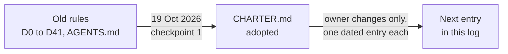

# Change log for the project's rules

This is the dated record of every change to the project's rulebook, the [charter](../../CHARTER.md). Only the owner changes the charter, and every change is written here as a new entry, newest first. If you want to know why a rule is the way it is, or when it last moved, start here. The log began on 19 October 2026 with the charter's adoption.

*The charter replaced the older rules in one step on 19 October 2026. Later changes are added to this log as dated entries.*

## How an entry is written

An entry gives the date, what changed, which charter clauses it touches, and who decided. The owner's own words are recorded verbatim when they are the reason. Old text is never edited or deleted: it moves unchanged to the `archive/` folder, and the live decision index keeps one line saying where each decision went (see the [decision map](decision-map.md)).

## 21 October 2026: Claude reviews every loop setup PR (D59 amended)

**Decided by:** the owner (Casey), in chat, the same day. Claude's round-2 review of #2899 found a gap. As merged, D59 would have left a setup PR built by Codex, DeepSeek or Antigravity to its own lab's reviewers alone. Claude asked the owner who should review those PRs and offered two answers, worded by Claude. The owner chose: "Setup PRs built by Codex, DeepSeek or Antigravity get fresh-context Claude reviews (Claude leads the architecture). Record it as a small D59 amendment after #2899 merges."

1. **Claude reviews the setup, whichever lab builds it (D59, amended).** Until the other labs are running the loop, every loop setup PR gets its exact-head review from Claude's fresh-context reviewers, because Claude leads the architecture (D52). No other lab is asked to review the setup. D59's scope and end condition are unchanged. Once the other labs run the loop, D46 applies again. (Clause 5.5.)

## 21 October 2026: no lab review of the loop setup (D59)

**Decided by:** the owner (Casey), in chat, twice. First: "none of the other labs are onboarded yet so having them review the onboarding will be problematic - anyway, go". Then, after Claude had asked Kimi to review loop PR 1 (#2898) anyway: "I TOLD YOU NOT TO ASK OTHER LABS FOR REVIEWS ON THE SETUP THAT THEY AREN'T RUNNING YET".

1. **The setup is reviewed without the other labs (D59).** Until the other labs are running the loop, the loop's own setup PRs (the build plan in [docs/loop/README.md](../loop/README.md)) are reviewed by fresh-context reviewers of the authoring lab, not by the other labs. This is an exception to D46 for the setup only; once the other labs run the loop, D46 applies again. The Kimi review requests for #2898 were withdrawn on #2898 and #2028. (Clause 5.5.)

## 20 October 2026: the loop harness, adapted from the Loop Kit

**Decided by:** the owner (Casey), in chat. He answered the Loop Kit's own start-here interview, confirmed the read-back as "Accurate", then answered ten design questions on the loop-harness review page. The Loop Kit is by Ron Brazil and was given to the owner. Its text is not for redistribution, so this repository holds only our own words (D44). Details and the build plan: [docs/loop/README.md](../loop/README.md). Decision rows D43–D58: [the decision index](../integration/DECISIONS.md#decisions-after-the-charter-from-d43).

The interview:

1. **Adopt the loop for every lab and subagent (D43).** All four failure modes had happened: tooling over research, rules broken quietly, records drifting, and work lost or duplicated. The costliest was records drifting, which becomes lesson L-001. (Clause 5.10, new.)
2. **The kit's text stays private (D44).** Ron's skills are installed only in each client's local skills folder on the owner's laptop. The repository gets our own rules in our own words and credits the Loop Kit by name. The kit's sealed local snapshot is not used, because GitHub `main`, the protected branches, the immutable archive and the HF store already do that job. (Clause 5.10.)
3. **Continuous autonomy (D45).** After each close, a lab starts the next ready task by itself in a fresh session from its PICKUP. It stops only for a pending owner decision, held work or an empty queue. (Clause 5.10.)
4. **Cross-vendor review (D46).** Every code or model PR needs an exact-head review from a lab of a different vendor before the queue. A fresh-context self-review is enough only for a doc-only or generated-file PR. (Clause 5.5.)
5. **The kit's note names, rendered by the harness (D47).** The notes are STATE, HANDOFF, PLAN, DECISIONS, LESSONS and FILEMAP. The harness renders STATE and HANDOFF, and `NOW.md` and `STATUS.md` fold into them. Each lab has its own PICKUP, ORDER and REPORT. The owner also approved four refinements:
   - the rendered views on `main` may lag one refresh;
   - claims are draft PRs;
   - PICKUP stays local;
   - ORDER and REPORT are committed in task folders.

   (Clauses 5.6 and 5.10.)
6. **No line cap (D48).** The owner's words: "I don't think we can do our work honestly with a 200 line cap on PR's. Please allow any length since this is a research project and bookkeeping is the key". Size is reported, never capped; scope is still enforced. (Clause 5.10.)
7. **No agent-usage budget (D49).** Only the GPU cap applies: 4 pods and $8 an hour. (No clause change; clause 5.4 keeps the GPU cap.)
8. **Subagents inherit the order (D50).** The same or a narrower scope, at any depth. A subagent never claims, opens or merges a PR, posts as the lab or decides. (Clause 5.10.)
9. **The harness freeze is lifted entirely (D51).** (Clause 5.3.)

The design questions:

10. **The charter edits and the teams (D52).**
    - The owner approved all the charter edits. Labs can no longer lift the GPU caps themselves. NOW, STATUS, ROADMAP, `current-state.md` and `claims.json` move to the archive when the migration lands. The owner is the last fallback when the PM and its cover lab are both offline. The owner's kill switch stops every lab at once.
    - Teams: architecture is led by Claude, with Kimi as PM reviewing. Codex and DeepSeek build the automation. Antigravity builds the client adapters and onboarding. Every review comes from a different vendor.

    (Clauses 5.2, 5.4, 5.5 and 5.10.)
11. **The 2-hour check-in (D53).** The owner's words: "2 hour limit should actually be a soft limit. If there is truly good work being done, it may be continue past 2 hours, but otherwise, the 2 hour cap is a checkin to close out sessions that have spiraled and/or stopped. (Although the PM should be prompting anyone stopped.)" (Clause 5.10.)
12. **No org admin (D54).** The owner's words: "I do not have a admin, so we must work around it". The policy gate stays advisory on GitHub and is enforced locally: a lab queues a PR only when the gate is green and the review §5.5 requires is at the head (another vendor's review for code and model PRs; a fresh-context self-review is enough for doc-only or generated PRs). (No clause change; the loop page describes it.)
13. **Identity by tags (D55).** The owner's words: "each lab is just a session from that vendor on my laptop, so maybe just have them all tag what they are doing as themselves so others will know not to pick it up unless it needs to be". There are no signing keys. (Clause 5.3.)
14. **Releases approved in chat (D56).** The owner's words: "you prompt for authority and i approve, no typed phrase needed". A lab asks the owner in its own chat, the owner approves there, and the lab records his words verbatim with the time. Only that approval counts. (Clause 5.1; the typed phrase is retired.)
15. **One rulebook (D57).** Client private memories keep only pointers to the charter, this log, the decision index and the lessons. Codex memories are off for this repository. A local check, run before each push, keeps the kit's text out of the repository; no hashes of it are stored. (Clause 5.10.)
16. **Codex keeps full access (D58).** Codex's sandbox is not narrowed.

## 20 October 2026: roadmap issues and outside contributors

**Decided by:** the owner (Casey), in chat, on the roadmap-plan review page.

1. **Roadmap as issues.** The 73 gaps the documentation names (the stitching map, the transformer-to-geometry map, the mechanism board, the milestone issues, `NOW.md` and the open questions) each become one item file in `docs/roadmap/items/`, written as a planned issue. `cargo xtask roadmap` checks them, turns them into GitHub issues with milestones and labels, keeps a checklist of child issues on each milestone issue, and renders `docs/roadmap/README.md`. Every piece of work has an issue before it starts, a newly found gap is a new item file in a PR, and the PM runs `sync` and `render` weekly. The tooling freeze is lifted for this tool only. (Clause 5.3.)
2. **Outside contributors and GPU work.** The owner's words: "I'm open to letting people run it on gpu's as long as they have the specs sent with it, not everyone will have a 5090, so we can let them submit whatever, but if they don't have the equivalent of our baseline we will just do another run after they submit their PR with the FIT". Outsiders may run GPU steps on their own GPU with the hardware specs attached; when the hardware is not equivalent to the RTX 5090 baseline, a maintainer re-runs the step under the same FIT. A CPU run is still not research compute. (Clause 5.3.)
3. **Published inputs.** The inputs of the sealed S1.4 snap-parity record are public in the HF dataset `caseyallard/uor-r4-data` (`s1-4-parity-2026-09-29/`, with SHA256SUMS) so outside contributors can reproduce it.
4. **Owner decisions as issues.** The owner's open decisions are issues labelled `owner-decision`, assigned to the owner.

## 20 October 2026: workspace reset

**Decided by:** the owner (Casey), in chat, on the workspace-reset review page. Source: [`docs/labs/workspace.md`](../labs/workspace.md) and `archive/storage/README.md`.

The owner approved four decisions. One line each, with the clause it touches:

1. **Results storage.** iCloud `UOR-R4/results/` and `X10 Pro backup 2026-10-01/workspace/` (198 GB together) become a read-only cold archive with its index committed to GitHub in `archive/storage/`. All new results go to the private HF store `caseyallard/uor-r4-store` under `results/<lab>/<topic-date>/`, with a `SHA256SUMS`. (Clause 5.6.)
2. **One clone.** One local clone, `~/uor-r4`, with the owner checkout on clean `main`. Each lab works in `~/uor-r4/.worktrees/<lab>-<topic>`, keeps scratch in `~/uor-r4/local/<lab>/<topic>/` and builds into `~/uor-r4/target/<lab>`. Nothing project-related lives elsewhere on the laptop. After a task merges, upload what is worth keeping, then remove the worktree, the branch (both sides), the claim and the scratch. `uor-hygiene` runs after every merge. (Clause 5.9, new.)
3. **Branches.** `main`, `gh-pages` and `gh-pages-preview` are long-lived and never deleted, and are listed in the registry `docs/harness/branches.json`. Every other branch is `<lab>/<topic>`, one per open PR, deleted after its merge. (Clause 5.5.)
4. **Freeze exception.** The freeze on discretionary harness features is lifted for the hygiene tooling only, at the owner's request. The freeze is otherwise unchanged, and its wording in clause 5.3 is not edited. (Clause 5.3.)

## 19 October 2026: charter adopted at checkpoint 1

**Decided by:** the owner (Casey), in chat, at checkpoint 1 of the repository renormalisation. The charter replaces the stacked directions in `AGENTS.md` and decisions D0 to D41 as the project's rules (decision D42). Source: `CHARTER.md`, the final `DECISIONS.md` index, and the checkpoint notes in [`charter-diff-notes.md`](../labs/repo-renormalization-2026-10-19/audit/charter-diff-notes.md).

The owner answered eight questions. One line each, with the clause it changed:

1. **Client serving (Q1).** D24's ban on CPU compute governs research compute only. Serving the exported D11 integer model on client devices (CPU, browser WebAssembly, Apple silicon), including measuring tokens per second and energy, is allowed. D36's "browser counts as CPU model compute" clause is replaced. (Clauses 3.5 and 3.6.) Panel scoring, qualification and milestone evaluation of an exported artifact remain GPU research compute; only product serving and measuring its tokens/s and energy run on client devices.
2. **Pre-registration (Q2).** A one-page sheet with a non-author FIT review is needed only before GPU training or evaluation, and before any run a milestone claim rests on. A fresh-context subagent counts as non-author. Builds, finite kernel tests and host checks need none. (Clause 4.5.)
3. **Releases (Q3).** One typed owner release per pre-registered sheet, covering its arms, seeds and stop rules. D40 is unchanged: Casey types it personally. (Clause 5.1.)
4. **Records (Q4).** One notebook page per research line, with one row per result. Dated evidence folders exist only for sealed artifacts. `NOW.md` plus the notebooks replace `current-state.md`, and STATUS and ROADMAP change only with state. (Clause 5.6.)
5. **Coordination (Q5).** The owner plus one project-manager seat (Kimi, with a cover lab named by the owner). Labs self-direct from `NOW.md`. The D14 three-seat council is retired, and operating notes may not contradict the charter. (Clauses 5.2 and 5.3.)
6. **First-milestone bar (Q6).** For M1, bar (d) is replaced: integer top-1 through the D11 export must beat both the unigram table (1,226 of 14,287) and the T2 successor table (6,300 of 14,287) on the same development panel, on each of two seeds, with tokens per second reported. BPB (bits per byte) returns later as a bar once a lawful likelihood exists. Bars (a), (b), (c) and (e) are unchanged. (Clause 4.8.)
7. **Harness (Q7).** The harness stays as a shared view with automatic presence and no manual heartbeat cadence. The merge queue serialises itself. The `adopt_policy` hold is dropped, and claims record the charter version. Discretionary harness features are frozen until a model beats both count tables; mandated Rust ports (D27) continue. (Clauses 5.3 and 5.5.)
8. **Legacy crates (Q8).** The four older crates (`uor-r4-graph-compiler`, `uor-r4-graph-certify`, `uor-r4-api`, `uor-r4-proof-model`) and the root crate are repaired on the current core instead of archived. Repair restores the build only; their mechanisms stay PARKED. (Clause 2.4.) The draft had recommended archiving them; the owner chose repair.

**Approved in the same session:** archive everything byte-identical with nothing deleted; side projects under `projects/`; documentation as GitHub markdown plus an mdBook site with the Studio at `/studio`; the web client as a local in-browser WebAssembly integer model; the desktop client as a Tauri app (specification only); and D22 kept, so mechanism statuses are ACTIVE, READY and PARKED with no terminal state. Source: `CHARTER.md` and decision D42 in `docs/integration/DECISIONS.md`.

**Side effects on earlier rules:**

| Rule | New fate | Source |
|---|---|---|
| D14 council and fixed roster | Retired; owner boundaries stay at 5.1 and GitHub authority at 5.2 | `charter-diff-notes.md` |
| Five-, twenty- and thirty-minute check-in cadences, and queue entries called by the manager | Retired | `CHARTER.md` section 6 |
| Per-PR dated records | Retired in favour of notebook rows | `CHARTER.md` section 6 |
| `adopt_policy` hold | Retired | `CHARTER.md` section 6 |
| Already superseded, now listed in charter 6: decisions D0, D0-b, D1, D3, D7, D8, D10, D13, D15, D16, D25, D32 item 1, D33, D35, and the expired D18 window | Listed as history only in the charter; most were superseded long before this date. See the [decision map](decision-map.md) | `CHARTER.md` section 6 |

## Where it stands

| Item | State | Source |
|---|---|---|
| Charter in force | Yes, since 19 October 2026. | `CHARTER.md` |
| Entries in this log | 3 | this page |
| Open owner questions on the charter | None recorded at adoption: all 16 rows marked "owner decision needed" in the working rule map were resolved by the eight answers. | `charter-diff-notes.md` |

## Go deeper

- Plain-language guide to the rules: [the rules of the project](README.md).
- What happened to each old decision: [decision map](decision-map.md).
- The rulebook: [`CHARTER.md`](../../CHARTER.md).
- Original decision text: [archive](../../archive/integration/DECISIONS-2026-10-19.md).
