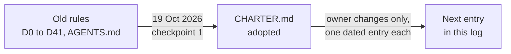

# Change log for the project's rules

This is the dated record of every change to the project's rulebook, the [charter](../../CHARTER.md). Only the owner changes the charter, and every change is written here as a new entry, newest first. If you want to know why a rule is the way it is, or when it last moved, start here. The log began on 19 October 2026 with the charter's adoption.

*The charter replaced the older rules in one step on 19 October 2026. Later changes are added to this log as dated entries.*

## How an entry is written

An entry gives the date, what changed, which charter clauses it touches, and who decided. The owner's own words are recorded verbatim when they are the reason. Old text is never edited or deleted: it moves unchanged to the `archive/` folder, and the live decision index keeps one line saying where each decision went (see the [decision map](decision-map.md)).

## 19 October 2026: charter adopted at checkpoint 1

**Decided by:** the owner (Casey), in chat, at checkpoint 1 of the repository renormalisation. The charter replaces the stacked directions in `AGENTS.md` and decisions D0 to D41 as the project's rules (decision D42). Source: `CHARTER.md`, the final `DECISIONS.md` index, and the checkpoint notes in `local/renorm/audit/charter/final/charter-diff-notes.md`.

The owner answered eight questions. One line each, with the clause it changed:

1. **Client serving (Q1).** D24's ban on CPU compute governs research compute only. Serving the exported D11 integer model on client devices (CPU, browser WebAssembly, Apple silicon), including measuring tokens per second and energy, is allowed. D36's "browser counts as CPU model compute" clause is replaced. (Clauses 3.5 and 3.6.)
2. **Pre-registration (Q2).** A one-page sheet with a non-author FIT review is needed only before GPU training or evaluation, and before any run a milestone claim rests on. A fresh-context subagent counts as non-author. Builds, finite kernel tests and host checks need none. (Clause 4.5.)
3. **Releases (Q3).** One typed owner release per pre-registered sheet, covering its arms, seeds and stop rules. D40 is unchanged: Casey types it personally. (Clause 5.1.)
4. **Records (Q4).** One notebook page per research line, with one row per result. Dated evidence folders exist only for sealed artifacts. `NOW.md` plus the notebooks replace `current-state.md`, and STATUS and ROADMAP change only with state. (Clause 5.6.)
5. **Coordination (Q5).** The owner plus one project-manager seat (Kimi, with a cover lab named by the owner). Labs self-direct from `NOW.md`. The D14 three-seat council is retired, and operating notes may not contradict the charter. (Clauses 5.2 and 5.3.)
6. **First-milestone bar (Q6).** For M1, bar (d) is replaced: integer top-1 through the D11 export must beat both the unigram table (1,226 of 14,287) and the T2 successor table (6,300 of 14,287) on the same development panel, on each of two seeds, with tokens per second reported. BPB (bits per byte) returns later as a bar once a lawful likelihood exists. Bars (a), (b), (c) and (e) are unchanged. (Clause 4.8.)
7. **Harness (Q7).** The harness stays as a shared view with automatic presence and no manual heartbeat cadence. The merge queue serialises itself. The `adopt_policy` hold is dropped, and claims record the charter version. Discretionary harness features are frozen until a model beats both count tables; mandated Rust ports (D27) continue. (Clauses 5.3 and 5.5.)
8. **Legacy crates (Q8).** The four older crates (`uor-r4-graph-compiler`, `uor-r4-graph-certify`, `uor-r4-api`, `uor-r4-proof-model`) and the root crate are repaired on the current core instead of archived. Repair restores the build only; their mechanisms stay PARKED. (Clause 2.4.) The draft had recommended archiving them; the owner chose repair.

**Approved in the same session:** archive everything byte-identical with nothing deleted; side projects under `projects/`; documentation as GitHub markdown plus an mdBook site with the Studio at `/studio`; the web client as a local in-browser WebAssembly integer model; the desktop client as a Tauri app (specification only); and D22 kept, so mechanism statuses are ACTIVE, READY and PARKED with no terminal state. Source: `CHARTER.md` and decision D42 in `docs/integration/DECISIONS.md`.

**Side effects on earlier rules:**

| Rule | New fate | Source |
|---|---|---|
| D14 council and fixed roster | Retired; owner boundaries stay at 5.1 and GitHub authority at 5.2 | `charter-diff-notes.md` |
| Five-, twenty- and thirty-minute check-in cadences, and queue entries called by the manager | Retired | `CHARTER.md` section 6 |
| Per-PR dated records | Retired in favour of notebook rows | `CHARTER.md` section 6 |
| `adopt_policy` hold | Retired | `CHARTER.md` section 6 |
| Decisions D0, D0-b, D1, D3, D7, D8, D10, D13, D15, D16, D25, D33, D35 | Listed as history only in the charter; most were superseded long before this date. See the [decision map](decision-map.md) | `CHARTER.md` section 6 |

## Where it stands

| Item | State | Source |
|---|---|---|
| Charter in force | Yes, since 19 October 2026. | `CHARTER.md` |
| Entries in this log | 1 | this page |
| Open owner questions on the charter | None recorded at adoption: all 16 rows marked "owner decision needed" in the working rule map were resolved by the eight answers. | `charter-diff-notes.md` |

## Go deeper

- Plain-language guide to the rules: [the rules of the project](README.md).
- What happened to each old decision: [decision map](decision-map.md).
- The rulebook: [`CHARTER.md`](../../CHARTER.md).
- Original decision text: [archive](../../archive/integration/DECISIONS-2026-10-19.md).
