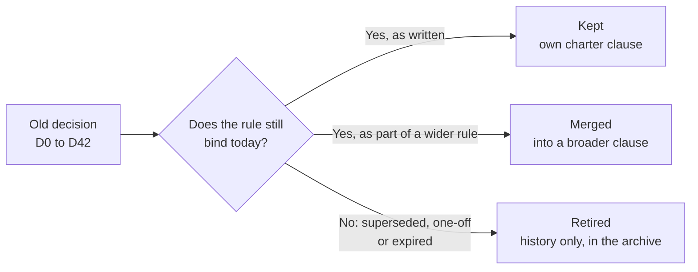

# Where each old decision went

Before 19 October 2026 the project's rules lived in 43 numbered decisions (D0 to D41, including a variant called D0-b) and in a long instruction file. The owner replaced them with one short [charter](../../CHARTER.md). This page lists every decision and says what became of it: the rule lives on in a numbered charter clause, it was folded into a broader clause, or it is history only. Nothing was deleted. Every decision keeps its original heading in the [live index](../integration/DECISIONS.md), so old links still land, and the full original text is preserved unchanged in the [archive](../../archive/integration/DECISIONS-2026-10-19.md).

*The three fates. "Retired" applies to rules only. A research mechanism is never retired; see the [mechanism board](../mechanisms/README.md) and D22.*

## How to read the table

- **Kept** means the decision survives with its meaning and has a home in the charter.
- **Merged** means its content now lives inside a clause that also covers other decisions.
- **Retired** means it no longer binds. It was superseded by a later decision, was a one-off order, or had a time limit that has passed. Its text stays in the archive.
- Clause numbers such as 3.6 refer to sections of `CHARTER.md`. Section 1 is the mission, 2 the products, 3 the technical constraints, 4 the evidence rules, 5 the workflow and 6 the retired list.
- The fate column follows the final `DECISIONS.md` index adopted with the charter (decision D42). It differs from the working rule map in one place: it files D14 as merged, because its owner boundaries and GitHub authority survive while its council is retired.

## The table

| Decision | What it said (one sentence) | Fate | Charter home |
|---|---|---|---|
| D0 | Serving forbids dense matrix multiplication; first form of the sparsity test, replaced the same day by D0-b. | Retired | Superseded by D0-b; its sparsity test survives as D5 (3.9). |
| I1 to I5 | Serving efficiency invariants: sparse access, bounded candidates, bytes per token, multiplier-free kernels, exact memory. | Kept | 3.9 (multiplier-free kernels relaxed by D80 and D81, 28 Oct 2026: the integer multiply and divide are allowed) |
| D0-b | Additive linear maps adopted as a serving stepping stone. | Retired | Superseded by D11 (serving) and D25/D30 (no dense maps). |
| D1 | Falsify a mechanism before extending it. | Retired | Superseded by D2, D12, D20 and D22; a negative now closes only a configuration (4.1). |
| D2 | A mechanism's contribution is judged by measured ablation; enablers are a separate class. | Merged | 4.1 (enablers survive as PARKED with reopen conditions) |
| D3 | Takeover clarification, including an offline matmul permission. | Retired | Superseded by D25/D30; the permission was withdrawn. |
| D4 | Goal decomposition and the geometry gate: advantage is measured against controls. | Merged | 4.4 (lawful non-neural controls only, per 3.10) |
| D5 | Per-token parameter sparsity is the terminal serving invariant. | Kept | 3.9 (the D5-b form) |
| D6 | The target objective is a long-range information probe. | Merged | 4.4 (long-range probe items plus count-table controls) |
| D7 | Adopt the integrated attention-language programme. | Retired | Superseded by D8 and D19. |
| D8 | Correct the training method and reference ladder. | Retired | Superseded by D32/D37 (training) and D28 (no neural reference). |
| D9 | Prevent experiment loops; a repeat needs new causal evidence. | Merged | 4.4 (pivot note) and 5.3 (intent note) |
| D10 | A converted open-weight backbone as the interim chat vehicle. | Retired | Superseded by D11. |
| D11 | One native, multiplier-free, transformerless integer serving contract for every lab. | Kept | 3.6 (amended by D80 and D81, 28 Oct 2026: the integer multiply and divide are allowed, and floats stay banned) |
| D12 | Gates promote, never kill; reopen geometric candidates; keep a toolbox. | Merged | 4.1 (ACTIVE, READY, PARKED; no terminal status) |
| D13 | Record of the 29 September two-track plan. | Retired | Superseded by D14, D18 and D19. |
| D14 | Durable autonomous labs, GitHub as authority, a three-seat council. | Merged | 5.1 (owner boundaries) and 5.2 (GitHub authority); the council is retired (owner, 19 Oct). |
| D15 | Converted students may become served candidates after an audit. | Retired | Superseded by D17; excluded by D28 and D11. |
| D16 | Working rules from the 29 September council. | Retired | Superseded by D17; the council is retired. |
| D17 | Transformer-free conversion; parity decisions with paired seeds and measured tolerance. | Merged | 4.3 |
| D18 | One retrieval question for 1 to 14 October; other tracks parked. | Retired | The window expired; its re-entry gate travels with D38 (3.9). |
| D19 | Grounded conversation and durable memory come first; self-review allowed. | Merged | 1 (mission) and 5.5 (delivery) |
| D20 | Geometry stays first; the no-loss rule is suspended only after exhaustion. | Merged | 3.1 and 4.1 (with no terminal status, no suspension procedure is needed) |
| D21 | Three non-moving results on one line force a pivot; one-off lab orders of 9 October. | Merged | 4.4 (pivot note); the lab orders are retired as executed or overtaken. |
| D22 | A negative closes a configuration, never a mechanism; power and transfer rules; five closures reopened. | Kept | 4.1 and 4.3 |
| D23 | No softmax anywhere, including losses, sampling, teachers and equivalent forms. | Kept | 3.2 |
| D24 | No CPU model compute, and no GPU on work that cannot change a decision. | Kept (scope narrowed) | 3.5, now research compute only; serving on client devices is allowed (3.6). |
| D25 | Geometric operator phase: squash and matmul bans, GPU-only compute, rule freeze. | Retired | Superseded by D32/D37; its bans live on in 3.2 and 3.3. |
| D26 | Vast.ai is the default pod provider; Runpod is the emergency backup; caps of 4 pods and $8 per hour. | Kept | 5.4 |
| D27 | Rust first, with the uor-foundation crates as the shared floor. | Kept | 3.11 |
| D28 | No transformer or neural comparisons until the native system works end to end. | Kept | 3.10 |
| D29 | No banned mechanism in any compiled or loaded module, vendor content included. | Kept | 3.4 |
| D30 | No matmul or softmax anywhere without wrapper laundering; Rust only; GPU-only heavy compute; pod kernel builds. | Merged | 3.2, 3.3, 3.4, 3.5 and 3.11 |
| D31 | No result is ruled out on an instrument technicality. | Kept | 4.2 |
| D32 | Discrete ternary, Hamming and quaternion substrate; no float in model computation; zeta-phase exception. | Merged | 3.7 (discrete path stays active; the float ban was revised by D37), 3.8, 3.12 and 3.1 |
| D33 | Delegated owner release for the first A2 pilot. | Retired | One-off; superseded by D40. |
| D34 | Revised attention and memory sequence: reranker-first read plus a D19 object-store crate. | Merged | 5.8 (the approved sequence, kept in `NOW.md`) |
| D35 | A seed-2 packet re-issue is required before any seed-2 go. | Retired | Superseded by D39. |
| D36 | GitHub Pages keeps the last good deploy until a D11 WebAssembly engine lands. | Merged | 2 (web client) and 3.6; its "browser serving counts as CPU model compute" clause is replaced, and the legacy crates are repaired (2.4). |
| D37 | Float is legal in offline training only, with a reported export gap. | Kept | 3.7; the owner's reason for the bans is quoted in 1, and archived sheets are handled in 4.5. |
| D38 | D5 split into D5-a (residency) and D5-b (per-token sparsity). | Kept | 3.9 |
| D39 | M1 closing bar, reachability gate, post-qualification sequence, lab self-direction. | Merged | 4.8 (bar (d) replaced), 4.2, 5.8 and 5.3 |
| D40 | Owner-identity phrases are typed by the owner personally. | Kept | 5.1 (the K16 ratification is a retired one-off) |
| D41 | One-time offline donor corpus exception (`distill-d1`), on binding conditions. | Kept | 3.10 (sole exception), 5.1 and 5.8 |
| D42 | The owner adopts the charter and answers eight checkpoint questions. | Kept (as the adoption record) | The charter itself; see the [change log](changes.md). |

## Tally

Counting the rows above (excluding the I1 to I5 row and D42): 14 decisions kept, 15 merged and 14 retired, which is 43 decision entries from D0 to D41 including D0-b. This is a count of the table, derived from the live index in `DECISIONS.md`; it is not a separate record.

## Where it stands

| Item | State | Source |
|---|---|---|
| Charter | Adopted 19 October 2026. | `CHARTER.md`; [change log](changes.md) |
| Live decision index | Each entry keeps its heading, a one-sentence summary and a fate line. | `docs/integration/DECISIONS.md` |
| Full original text | Preserved unchanged in the archive. | [archived original](../../archive/integration/DECISIONS-2026-10-19.md) |
| Rule-by-rule mapping | Working document of 258 individual rules to charter clauses, kept in the audit directory. | [`rule-map.md`](../labs/repo-renormalization-2026-10-19/audit/rule-map.md) |

## Go deeper

- Plain-language guide to the charter: [the rules of the project](README.md).
- Dated record of every charter change: [change log](changes.md).
- Mechanism statuses and what would reopen a PARKED one: [mechanism board](../mechanisms/README.md).
