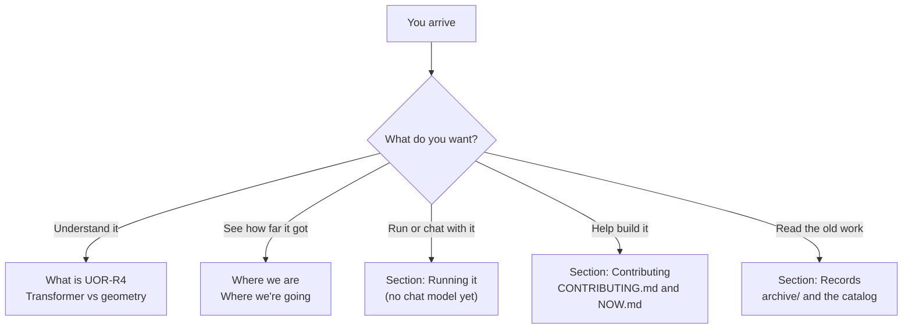

# Frequently asked questions

**In one paragraph.** These are the questions newcomers and would-be contributors ask most often, answered plainly. The short version: UOR-R4 is a pre-alpha research project that tries to build a fast language model out of geometry instead of a transformer's expensive arithmetic. Parts of it are built and tested. No model it has trained holds a useful conversation yet, and the best one so far predicts the next word worse than a simple table of word counts ([STATUS](../../STATUS.md)). Words in the answers are defined in the [glossary](./glossary.md).

*Which section of this page to read first.*

Claims are labelled **proof** (follows from definitions or code), **measurement** (from a recorded run) or **hypothesis** (untested), as in [`docs/formal_vocabulary.md`](../formal_vocabulary.md). `NOT_RUN` means a test was planned and never executed. It is not a pass.

## The basics

### 1. What is UOR-R4, in plain words?

It is an open research project that asks one question: can a language model run on an ordinary laptop or in a browser if its core arithmetic is geometry (rotations, exact whole-number addresses built from primes, lookup tables) instead of the huge decimal multiplications inside today's chat AIs? The project is pre-alpha and the answer is not known yet. See [what UOR-R4 is](./what-is-uor-r4.md) and the [charter](../../CHARTER.md), section 1.

### 2. Is this a transformer?

No, by design. The charter says the project is "not a transformer" (section 1), bans matrix multiplication (section 3.3) and excludes "a dense model disguised as lookup tables" from serving (section 3.6) ([charter](../../CHARTER.md)). The current model (`crates/uor-r4-discrete`) reads earlier words with three bounded reads ([Route](../mechanisms/route-read.md), [Flock](../mechanisms/flock-read.md), [Relation](../mechanisms/relation-read.md)) and has no feed-forward block at all. But be careful with the history: the project's older float models (7 million to 214 million parameters) used softmax, matrix multiplication and a SiLU activation (a smooth squashing curve), so they did not follow today's rules (**measurement**, [geometric stack](../mechanisms/geometric-stack.md)). The comparison page is [transformer vs geometry](./transformer-vs-geometry.md).

### 3. Does it work yet?

No. Zero of the eight milestones are complete ([STATUS](../../STATUS.md)). What works is the parts: for example the integer substrate passes 25 of 25 admitted GPU construction controls (**measurement**, [K16 qualification](../labs/k16-rows-qualification-2026-10-18/README.md)), and the whole-number serving engine runs in a browser and contains no multiply, divide or decimal instruction in 7 of 7 serving functions (**measurement**, [WASM record](../labs/wasm-serving-runtime-2026-10-18/README.md)). Passing a control is not a language result. No two replacements have been trained together into a model that beats the count tables ([open questions](../research/open-questions.md)).

### 4. How good is the best model so far?

Not good. On 14,287 development rows, the best trained arm (K16-A) got its first guess right 65 and 463 times on its two seeds. A table of overall word counts gets 1,226, and a table that looks up the last word and returns its most common successor gets 6,300 (**measurement**, [K16 outcome](../labs/k16-outcome-call-2026-10-19/README.md), [count tables](../../archive/labs/host-diagnostics-2026-10-17/README.md)). The model has to beat both tables before the first milestone can close ([charter](../../CHARTER.md), section 4.8).

### 5. Why does it lose to a count table? Do you know the cause?

The cause is not established. One early suspect, that too few distinct starting vectors capped the score, was tested and did not explain it: training broke much of the aliasing and the score stayed low ([K16 outcome](../labs/k16-outcome-call-2026-10-19/README.md)). The open candidates are how well the output step can rank, the read, the address key (it takes only 5 values to order up to 256 cells, a **proof** from the kernel source in the architect's audit; whether that causes the low score is a **hypothesis**) and the training schedule (one pass sees under half the training targets). The next test, W2 (FIT-reviewed and queued, awaiting an owner release), decides whether the wall is the representation or the learning law ([open questions](../research/open-questions.md)).

### 6. Will it reach frontier capability?

That is the goal, in the owner's words "almost frontier level capability" on a laptop ([charter](../../CHARTER.md), section 1). It is a **hypothesis**. Nothing measured so far supports or refutes it, and the data and model scale needed are not established. The shortest planned path is in [where we're going](./where-were-going.md).

## The rules

### 7. Why no softmax?

The owner's reason is cost, not taste: "to ban expensive operations" ([charter](../../CHARTER.md), section 1). Softmax turns scores into probabilities with exponentials and a sum over everything, and it hides a dense global normalisation. The charter bans it, and every softmax-like function, in the model, its training, its comparators and any renamed or table form (section 3.2). The price is real: every earlier read that learned a ranking had softmax helping it somewhere in training, and the best softmax-free read was a recorded REJECT, 0.0172 bits per byte worse and 15% slower (**measurement**, [open questions](../research/open-questions.md), [record](../../archive/labs/softmax-free-read-2026-10-10/README.md)). Whether a softmax-free read can learn ranking at all is the project's biggest open question.

### 8. Why no matrix multiplication?

Matrix multiplication is nearly all of a transformer's arithmetic, so removing it is the point of the project ([charter](../../CHARTER.md), section 3.3). A geometric feed-forward block, such as the [Hamilton gate](../mechanisms/hamilton-gate.md), is allowed. A dense one is not. One mechanism, [spin-native weights](../mechanisms/spin-weights.md), matched a dense model's score but only by running a dense block multiplication, so it is PARKED.

### 9. Why use GPUs for research but laptops for serving?

They are different jobs. Research compute (training, evaluation, qualification) must run on the GPU, because host runs gave wrong timing and wrong evidence, and spending GPU only where a run can change a decision keeps costs down ([charter](../../CHARTER.md), section 3.5). The finished model, though, is meant to run on the user's own device: serving the exported integer file on a laptop CPU, in a browser or on Apple silicon is the product, and the GPU-only rule does not apply to it (section 3.6). Scoring an exported model for a milestone still counts as research compute.

### 10. Why can training use decimals when serving cannot?

Decimals train faster, and only the shipped file has to be integer ([charter](../../CHARTER.md), section 3.7, from decision D37). Any float-trained candidate must report its **export gap**, the quality lost when it is snapped to whole numbers, and a gap above the noise band disqualifies it. The current discrete model avoids the question because it is integer from end to end. See [serving and export](../model/serving-and-export.md).

### 11. Why primes, zeta zeros, E8 and quaternions? Do they actually help?

The owner's rule is "use geometry", because the bet is that exact geometry can replace dense arithmetic ([charter](../../CHARTER.md), section 1). What has been shown is narrow. An injective code is possible by counting ($16^4 = 65{,}536 \ge 4{,}096$, **proof**), and the PrimeZeta construction gives all 4,096 tokens distinct vectors (**measurement**). The address-structured table reached 1,351 of 3,847 targets at zero training, against 127 for the plain PrimeZeta start (**measurement**). But no run has shown that any geometric choice beats a plain alternative on language. Architectural priority is not measured advantage. See the [geometry chapters](../geometry/README.md).

### 12. Why so much process? What is a FIT sheet?

A **pre-registration sheet** is a one-page plan written before a run: the bar, the noise, the controls, the seeds, the cost and what each outcome decides. A **FIT** review is a check by someone other than the author that the test can answer its question. The project added this because early results kept turning out to be measurement artefacts ([what the project knows](../research/findings.md)). It also overdid it: in the week of 12 to 18 October only 11% of recorded lab work was a model result (**measurement**, [history](../research/history.md)). Since 19 October a sheet is required only before GPU training or evaluation and before any run a milestone claim rests on ([the rules](../rules/README.md)).

## Running it

### 13. Can I run it?

You can build it and run its checks, but you cannot chat with it, because no model trained under today's rules has been exported to the serving engine. From a clone, with the pinned Rust toolchain, the README's commands are `cargo check --locked -p uor-r4-discrete --lib` and `cargo test --locked -p uor-r4-discrete --lib`. These execute no model ([README](../../README.md)). Training needs CUDA GPUs rented through the project's tools and a personal release by the owner for each run ([training](../model/training.md)).

### 14. Is there a web or desktop app?

Not one you can use. The web client is meant to be a local model in a browser tab, and the desktop client a Tauri app with durable memory. Today the Studio interface and a WebAssembly build of the engine exist separately, the Studio still imports an older engine, and the desktop app is a specification only ([products](../products/README.md), [web client](../products/web-client.md), [desktop client](../products/desktop-client.md)).

### 15. What about the models on Hugging Face?

Four 214 million parameter checkpoints are public, but they are historical: trained before the no-softmax and no-matrix-multiplication rules, in the float form, and not the served model. Their chat variants rewrite and summarise usably, while code and arithmetic are wrong ([data and tokenizer](../model/data-and-tokenizer.md), [README](../../README.md#where-we-are)).

### 16. How fast is it? How much does it cost to train?

Tokens per second is the project's lead metric, and it has never been measured for the current model ([charter](../../CHARTER.md), section 1; [lut-serving](../mechanisms/lut-serving.md)). For cost, the audit quotes the K16 runs at "~1.2 h (~$2)", the chief architect's figure (section 7 of the [architect audit](../labs/course-correction-2026-10-18/audits/d37-reactivation-architect.md)), that is about 1.2 hours and $2 for all four K16 runs together. Spending is capped at 4 rented pods and $8 an hour across all labs ([charter](../../CHARTER.md), section 5.4). These are estimates, not invoices.

## Contributing

### 17. How can I contribute?

Start with the one-page plan, [NOW.md](../integration/NOW.md), then [CONTRIBUTING.md](../../CONTRIBUTING.md). Model work on the first four milestones is gated and owned by the labs. Work that is genuinely open to outsiders includes documentation and claim-wording fixes, reproducing a published negative result, and tooling that does not touch the model path. Post a short comment on the owning issue saying what you will do, work on a short branch, and open a pull request that says `References #N`. A maintainer runs the project's gates for you ([CONTRIBUTING](../../CONTRIBUTING.md)).

### 18. What are the labs, and who decides?

A **lab** is any contributor, human or AI, working under the charter. Labs so far include Claude, Codex and DeepSeek, with Kimi in the project-manager seat. The owner, Casey, decides the charter, the constraints, holds, spending, milestone bars and exceptions, and types every run release personally. The project manager sequences work, and labs choose tasks from `NOW.md`. Subagents review and test but never make critical decisions. See [the rules](../rules/README.md#who-decides-what).

### 19. What do ACTIVE, READY and PARKED mean? Is PARKED dead?

The three statuses describe how far a mechanism has got. **ACTIVE** is on the current model path, **READY** is built and tested but not yet trained in, and **PARKED** means the tested forms failed or broke a rule. PARKED is not dead: owner decision D22 says a negative closes one tested configuration, never a mechanism, and each PARKED page lists what would reopen it. Of 27 mechanisms, 10 are ACTIVE, 4 READY and 13 PARKED. See the [mechanism board](../mechanisms/README.md).

## Records

### 20. Where is the old research?

Nothing was deleted. Dated records from before 18 October moved unchanged into `archive/`, and a generated catalog lists them: [`archive/CATALOG.md`](../../archive/CATALOG.md). The story of what was tried is in [how the project got here](../research/history.md), the distilled lessons in [what the project knows](../research/findings.md), and one page per research line in the [notebooks](../research/notebook/README.md) and [lines](../research/lines/README.md). The pre-charter rulebook is preserved in [`archive/integration/DECISIONS-2026-10-19.md`](../../archive/integration/DECISIONS-2026-10-19.md).

### 21. What happened to the 437 of 512 and the 0.877 results I may have seen?

Both are old and narrow. The 437 of 512 replies were later judged to be panel fitting, and they fell to 0 of 128 on opened transfer rows ([native geometric engine](../mechanisms/native-geometric.md); for the current discrete M1 model, the pre-registered sealed `Fresh V2` transfer test has now run across two seeds, scoring `7,215` and `7,228` of `14,479` against `1,279` unigram and `6,582` `T2`, **measurement**, [m1-fresh-panel-transfer](../labs/m1-fresh-panel-transfer/README.md)). The 0.877 bits per byte was a float score on one 19.9 million parameter stack that used softmax and matrix multiplication; served through the integer engine it scored 0.933 against a 0.90 bar, and the two numbers were not measured on the same windows ([serving and export](../model/serving-and-export.md)). Neither is a result of the current model.

### 22. What is in `projects/`?

Seven side projects that are related to UOR-R4 but are not on the model's training or serving path, such as the SpiralCore network transport and a Lean proof scaffold. None of them is evidence that the model works. See [`projects/README.md`](../../projects/README.md).

### 23. Who is behind it, and what is the licence?

The citation file names Casey Allard and the UOR Foundation as authors, and the project is released under the MIT licence ([CITATION.cff](../../CITATION.cff), [LICENSE](../../LICENSE)).

### 24. How do I know the claims in these pages are honest?

Every number on a page is linked to a repository path, a pull request or an audit file. Each claim is labelled proof, measurement or hypothesis, and the repository runs a claim-wording check (`cargo run -q --locked -p uor-r4-claim-wording -- .`) that rejects strong proof wording unless the same line links a proof or certificate. If you find a claim that is wrong or unsourced, open an issue; that is a welcome contribution.

## Go deeper

- [What is UOR-R4](./what-is-uor-r4.md) and [transformer vs geometry](./transformer-vs-geometry.md).
- [Where we are](./where-we-are.md) and [where we're going](./where-were-going.md).
- [Glossary](./glossary.md): every term used here.
- [The rules in plain language](../rules/README.md) and the [charter](../../CHARTER.md).
- [Open questions](../research/open-questions.md): what is still unknown.
