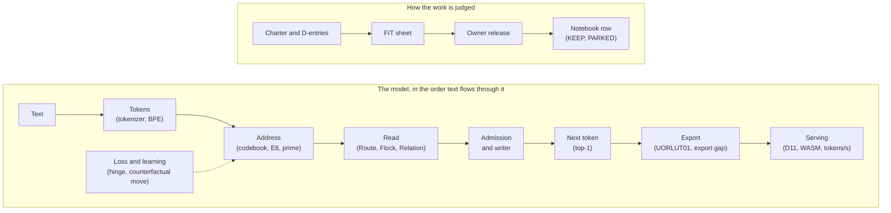

# Glossary

**In one paragraph.** UOR-R4 uses a lot of words that come from three places: language models (token, softmax, BPB), geometry (quaternion, E8, icosian) and the project's own rulebook (FIT, KEEP, PARKED). This page defines each one in a sentence or two and links to the page that explains it properly. Words are in alphabetical order. If you meet a code name such as K16 or A8 in a record, look for it here too. The project is pre-alpha: 1 of its 8 milestones is complete and no model holds a useful conversation yet ([STATUS](../../STATUS.md)).

*Where each family of terms sits. The top row is the path of one prediction. The bottom row is how a piece of work is approved, run and recorded.*

## How to read this page

- A word in **bold** at the start of an entry is the term. "See" points to the entry that holds the definition.
- Claims are labelled **proof** (follows from definitions or code), **measurement** (from a recorded run) or **hypothesis** (an untested idea), as in [`docs/formal_vocabulary.md`](../formal_vocabulary.md).
- Numbers come from the linked page, which cites its own source. `NOT_RUN` means a test was planned and never executed. It is not a pass.

**Jump to:** [A](#a) · [B](#b) · [C](#c) · [D](#d) · [E](#e) · [F](#f) · [H](#h) · [I](#i) · [K](#k) · [L](#l) · [M](#m) · [N](#n) · [O](#o) · [P](#p) · [Q](#q) · [R](#r) · [S](#s) · [T](#t) · [U](#u) · [V](#v) · [W](#w) · [Z](#z)

## A

**A8.** The nickname of the address-structured cells table, the starting table of the current model, and of the training run that began from it. At zero training it let the reader reach 1,351 of 3,847 copy-successor targets, against 127 for the plain PrimeZeta start (**measurement**). Learning then eroded that gain, and the first training run stopped at its first checkpoint. See [address cells](../mechanisms/address-cells.md).

**ACTIVE.** A mechanism status: the mechanism is on the current model path. See [mechanism status](#mechanism-status).

**Address.** A token's place in the model. It is 4 blocks of 8 whole numbers, and each block is one of 16 fixed points of the E8 lattice. Exact token identity is kept separately from this geometric address. (A token's prime address, defined below, is a different thing: its exact name as a prime number.) See [the model, end to end](../model/architecture.md).

**Admission.** The shortlist step before the model picks a word. The 4,096 words sit in 256 cells, and the model opens only the few cells nearest to what its read points at. A word in an unopened cell can never be chosen, so admission caps everything before it (**proof**, by construction). See [admission](../mechanisms/admission.md).

**Artifact.** A saved model file together with the data, seed, settings and parameters that made it. The charter requires every artifact to bind all of these. See [charter](../../CHARTER.md), section 3.12.

**Attention.** The step in which a language model decides which earlier words matter. A transformer compares the newest word with every earlier word. UOR-R4 replaces it with three cheaper reads: [Route](#route-read), [Flock](#flock-read) and [Relation](#relation-read). See [transformer vs geometry](./transformer-vs-geometry.md).

## B

**Bar.** A pass line that is fixed before a run, so the result cannot be bent to fit afterwards. Bars are never narrower than the measured noise. See [the rules](../rules/README.md).

**BPB (bits per byte).** A score of how well a model predicts text: the average number of bits it needs for each byte. Lower is better. The older milestone bars use it (M4 asks for 0.90 or less). The current discrete model has no probabilities, so it cannot produce BPB, and on 19 October the owner replaced M1's BPB bar with a top-1 comparison. See [rank-margin](../mechanisms/rank-margin.md) and [charter](../../CHARTER.md), section 4.8.

**BPE (byte-pair encoding).** The way the tokenizer builds its pieces. It starts from the 256 single bytes and repeatedly glues the most common neighbouring pair into a new piece. The pinned tokenizer has 4,096 pieces: 3 special ones, 256 bytes and 3,837 merges. See [tokenizer](../mechanisms/tokenizer.md) and [data and tokenizer](../model/data-and-tokenizer.md).

**BVG-K (batched verified coordinates).** A faster version of the learning step. It scores K table entries in one GPU launch and commits them together only if their joint loss beats the best single move. Scoring was about 16 times faster at K=16 (**measurement**), and BVG-K was used in Stage T and the saved M1 model; its independent effect is not isolated. See [training](../model/training.md).

## C

**Carrier.** The small integer block the model passes along: 8 whole numbers drawn from a 16-root orbit of E8, moved by 64 exact signed actions. Four carriers make one token's vector. See [SpiralCore](../geometry/spiralcore.md) and [architecture](../model/architecture.md).

**Cell.** One of the 256 drawers that admission opens. A word's cell is the pair of roots of its first and last block, so the grid is 16 by 16 and each cell starts with 16 words (training can move words between cells). See [admission](../mechanisms/admission.md).

**Charter.** The project's short rulebook, adopted by the owner on 19 October 2026. It replaced the older stack of instructions and numbered decisions. Only the owner changes it. See [CHARTER.md](../../CHARTER.md) and [the rules in plain language](../rules/README.md).

**Codebook.** The table that gives each of the 4,096 tokens its starting vector. In the current model it is built by a fixed recipe, not drawn at random: see [PrimeZeta](#primezeta-codebook) and [A8](#a8). See [data and tokenizer](../model/data-and-tokenizer.md) and [architecture](../model/architecture.md).

**Control.** A run identical to the one being tested except for the one thing under test. Controls here must be lawful non-neural baselines, such as count tables. See [the rules](../rules/README.md).

**Counterfactual move.** One step of learning. The machine picks one table entry and tries all 16 of its legal states (staying put plus 15 rotations), counts the mistakes after each on a batch of 64 examples, and keeps the best only if it strictly beats staying put. There are no gradients. See [discrete learning](../mechanisms/discrete-learning.md) and [training](../model/training.md).

## D

**D-entries (D11, D22, D37 and the rest).** Numbered owner decisions, from D0 to D41, that used to be the project's rulebook. The charter now holds the rules that still bind, and the [decision map](../rules/decision-map.md) says what became of each decision. The ones you will meet most are [D11](#d11), [D22](#d22) and [D37](#d37).

**D11.** The serving contract: the finished model runs with whole numbers only. It has five rules covering arithmetic, access, architecture and evidence. No floating point, transcendental arithmetic, dense matrix multiplication or transformer backbone is allowed; D80 and D81 (28 Oct 2026) permit the hardware integer multiply and divide. See [serving and export](../model/serving-and-export.md).

**D19 object store.** A store that keeps bytes exactly, in a tree of fingerprinted pieces, so repeats are stored once and any range can be checked. It is built and tested (20 integration tests pass in the delivery record, 60 after later work). Joining it to the selected model is in progress; M3 is not qualified. See [object store](../mechanisms/object-store.md).

**D22.** The owner's rule that a negative result closes one tested configuration, never a mechanism. Stopping a mechanism needs the owner. This is why no mechanism has a "retired" status. See [the rules](../rules/README.md) and [decision map](../rules/decision-map.md).

**D24.** The owner's rule of 12 October 2026 that no model compute runs on the CPU: training, evaluation and every research measurement of the model are GPU work. Serving the exported [D11](#d11) integer artifact on a client device is the product, not research compute (charter 3.6). See [the rules](../rules/README.md).

**D37.** The owner's rule of 18 October that floating point is legal in offline training. Softmax-like functions and matrix multiplication stay banned, and every float-trained candidate must report its export gap. See [training](../model/training.md).

**D80, D81.** Owner decisions of 28 Oct 2026: served integer code may use the hardware integer multiply (D80) and divide (D81). Floats, transcendentals and dense matmul stay banned in serving. See [serving and export](../model/serving-and-export.md).

**DEV panel.** The set of 14,287 development rows used to score models while they are being designed. A model's first guess is right on some number of them (see [top-1](#top-1)). The "fresh" panel is a separate sealed set, scored once after the design is chosen. See [K16 outcome](../labs/k16-outcome-call-2026-10-19/README.md).

**Diagnostic stop.** A run ended early on purpose, by a stop rule written down beforehand, so the cause can be found. It is not a negative result and not a failure of the mechanism. See [research notebooks](../research/notebook/README.md).

## E

**E8.** A famous lattice in eight dimensions with 240 "root" points. The project builds a pairing of the 120 icosians with a golden-ratio-scaled copy of themselves and gets these 240 roots. The current model uses only a 16-root piece of E8, not all 240. See [E8, H4 and the 600-cell](../geometry/e8-h4-and-the-600-cell.md).

**Embedding.** In a transformer, the learned list of decimals that stands for each token. UOR-R4's counterpart is the constructed integer [codebook](#codebook). See [PrimeZeta](../mechanisms/prime-zeta-codebook.md).

**Exact memory.** The idea of writing a fact once under an exact name (a prime-based address) and reading it back exactly, instead of smearing it across weights. The trained forms tested so far missed their bars, so the mechanism is PARKED. See [exact memory](../mechanisms/exact-memory.md).

**Exact turn memory.** A table keyed by the first 8 tokens of the user's turn that returns the reply's opening word. On DEV it named 598.7 and 598.3 of 1,226 reply openings at two seeds (claude-161). It does not yet carry a reply past its first word and is not served. See [pipeline map](../model/pipeline-map.md).

**Export gap.** The quality lost when a model trained with decimals is snapped into the whole-number file that ships. It is the served score minus the float score on the same evaluator. A float candidate whose gap exceeds the two-seed noise band is disqualified. On the FBS trunk it was measured on 29 Oct 2026: under `lut-stack/5` the served model is inside the bar on both seeds, net 6 and −8 rows against F_I 24 on DEV (claude-182). See [serving and export](../model/serving-and-export.md).

## F

**FBS.** The project's name for the three-branch tree that holds earlier words in order. The tree is built by [SpiralCore](#spiralcore) and gives the context at most 243 positions ($3^5$). See [SpiralCore](../geometry/spiralcore.md) and [SpiralCore/FBS projection](../mechanisms/spiralcore-fbs.md).

**FIT (TEST FITNESS: FIT).** The verdict of a review, by someone other than the author, that a pre-registered test is fit to answer its question. A fresh-context subagent counts as a non-author. A FIT releases nothing by itself: the lab's D67 pre-run review is also required, and D41's donor pass still needs the owner at dispatch. See [the rules](../rules/README.md) and [training](../model/training.md).

**Fixed-order backward.** The training backward pass sums in a fixed order, so two training runs give the same model byte for byte (claude-179). See [training](../model/training.md).

**Float.** Decimal (floating-point) arithmetic. Allowed in offline training under [D37](#d37), never in the served model. See [serving and export](../model/serving-and-export.md).

**Flock read.** An attention replacement modelled on a starling flock. The model picks about seven of the nearest earlier positions, rotates what each knows into its own point of view, and moves toward their consensus. Nothing is normalised and no weight is multiplied. It runs inside every Relation run, but its own value has never been isolated. See [Flock read](../mechanisms/flock-read.md).

**Fresh panel.** Rows that were never seen during design and stay sealed until a run is registered to score them. Every development gain must also report a fresh number. See [the rules](../rules/README.md).

## H

**H4.** The symmetry group of the 600-cell, a regular solid in four dimensions. Its 120 roots are the [icosians](#icosian). See [E8, H4 and the 600-cell](../geometry/e8-h4-and-the-600-cell.md).

**Hamilton gate.** A gate for a feed-forward layer that turns the gate signal into a rotation in four dimensions and rotates the value by it, so no sigmoid is needed. A rotation keeps a vector's length, so the gate steers a signal rather than switching it off. It is ACTIVE and trained in the discrete M1 composition and on the FBS trunk. See [Hamilton gate](../mechanisms/hamilton-gate.md).

**Hamming distance.** The number of positions at which two bit strings differ. It costs one XOR and one bit count. The model uses it as a tie-break inside its reads. See [VSA and Hamming distance](../geometry/vsa-and-hamming.md).

**Hamming read.** A look-back that compares 64-bit sign codes with XOR and a bit count, used by the copy heads and type heads (claude-146). The recall probe scored 0.98 to 0.99 at three seeds. Its integer kernel matches an f64 reference (claude-189); it is not yet in the served session. See [Hamming distance](../geometry/vsa-and-hamming.md) and [pipeline map](../model/pipeline-map.md).

**Hinge loss.** A loss that asks only whether the right answer beats its strongest rivals by a fixed gap. If it does, the loss is zero. If not, the loss is the shortfall. It needs no probabilities. The live version is an integer hinge. See [rank-margin](../mechanisms/rank-margin.md).

**Hold.** An owner order that stops a kind of work until the owner lifts it. Training, the second milestone's training and rental, and Stage B are held work. Since D65–D69, a lab runs held work on its own pre-run review, which reads the whole project first, and the owner can reverse it (AGENTS.md). A FIT review alone lifts none of them. See [charter](../../CHARTER.md), sections 5.1 and 5.10.

**Hopf map.** A map that takes a point on a four-dimensional sphere (a unit quaternion) to a point on an ordinary sphere. It forgets one angle, called the fibre, so many states cast the same shadow. The kept-fibre idea is built as a helper but is not part of the current read, and the mechanism is PARKED. See [the Hopf map and the kept fibre](../geometry/hopf-observation.md).

## I

**Icosian.** One of 120 unit quaternions that form the binary icosahedral group, a double cover of the icosahedron's 60 rotations (the icosahedron is a 20-sided solid). They are the vertices of the 600-cell, and their coordinates need the golden ratio, which is why exact golden-integer arithmetic is used (see Z[φ] below). See [E8, H4 and the 600-cell](../geometry/e8-h4-and-the-600-cell.md).

**Instrument.** A measuring tool, such as a test panel or a checker. If an instrument is faulty, that is a fix, not a negative result about the mechanism. See [what the project knows](../research/findings.md).

**Integer serving.** Running the finished model with whole numbers only: adds, shifts, comparisons and table look-ups, and since D80 and D81 the integer multiply and divide. This is [D11](#d11). Serving audits are green on 44 native symbol ranges and 7 of 7 WebAssembly functions, with the allowed integer multiplies and divides counted since claude-175 and used since claude-177 (**measurement**). The discrete M1 pair and the separate FBS trunk have been served this way. See [serving and export](../model/serving-and-export.md).

## K

**K16.** The runs of 18 October that opened a shortlist of K=16 cells. Four runs finished (two training objectives, A and R, with two seeds each). None was a KEEP. The two seeds of objective A got 65 and 463 of 14,287 first guesses right (**measurement**). See [K16 outcome](../labs/k16-outcome-call-2026-10-19/README.md).

**KEEP.** The verdict for a run that meets its own pre-registered mechanism target without a significant loss on the headline number. The work then iterates. It is not a final proof. See [the rules](../rules/README.md).

## L

**Lab.** Any contributor, human or AI, working under the charter. The registry holds four labs: Claude, Antigravity, DeepSeek and Kimi (Codex has left it). Kimi sits in the project-manager seat. Labs choose work from [PLAN.md](../../PLAN.md). See [the rules](../rules/README.md#what-labs-may-do-and-what-they-may-not).

**`lut-stack/5`, `lut-stack/6`.** Versions of the integer file format for the float-trained FBS trunk. `/5` keeps the rotations exact instead of snapping them to the 120 roots, which put the export gap inside its bar on both seeds and serves at 4,217 to 4,504 tok/s on the M1 laptop (claude-180 to 186). `/6` also carries the Hamming reads (claude-188); the session refuses `/6` until it serves them. See [serving and export](../model/serving-and-export.md).

## M

**M1 to M8 (milestones).** The eight GitHub milestones that define the road to an alpha release. **M1 is complete; M2 and M3 are in progress; M4–M8 are not complete.** In plain words:

| # | Meaning |
|---|---|
| M1 | It predicts text (a saved discrete model beats both count tables through the integer export) |
| M2 | It answers from memory (at least 256 of 512 development replies, and 40% on a fresh panel) |
| M3 | It remembers across sessions |
| M4 | It is served: exported to `UORLUT01` and run from the command line |
| M5 | It is cheap on a laptop, with the cost measured |
| M6 | It reasons and codes |
| M7 | It runs the same in a library, a command line and a browser |
| M8 | It is released as one checksum-pinned file |

Source: [language model](../products/language-model.md) and [where we're going](./where-were-going.md).

**Matmul (matrix multiplication, GEMM).** Multiplying a long list of numbers by a large grid of learned numbers. It is nearly all the arithmetic of a transformer, and the project bans it everywhere: training, tests, tools and serving. A geometric feed-forward block is allowed. A dense one is not. See [charter](../../CHARTER.md), section 3.3.

**Mechanism.** One geometric replacement for one part of a transformer, such as the read, the loss or the optimiser. The project tracks 28, each with its own page. See the [mechanism board](../mechanisms/README.md).

**Mechanism status (ACTIVE, READY, PARKED).** The only three statuses a mechanism can have:
- **ACTIVE**: on the current model path (12 mechanisms).
- **READY**: built and tested but not yet trained into a model (5).
- **PARKED**: the tested forms failed or broke a rule, and the page lists what would reopen it (11).

There is no "retired" status, by [D22](#d22). Source: [mechanism board](../mechanisms/README.md).

**MLP (feed-forward layer).** The block in a transformer that processes each token after attention, usually with big grids of multiplications and a gate. The [Hamilton gate](#hamilton-gate) is trained in M1 and on FBS; the [SpiralCore/FBS projection](../mechanisms/spiralcore-fbs.md) is trained on the separate FBS trunk only.

## N

**Nat.** A unit of prediction error: the natural logarithm of how surprised the model was. Lower is better; bits per byte is a related score.

**Notebook.** One page per line of research, with one row per result: date, what ran, the number, the bar, the verdict and an artifact link. Notebooks retain the results; [PLAN](../../PLAN.md) and rendered [STATE](../../STATE.md) carry the current plan and status. See [research notebooks](../research/notebook/README.md).

**NOT_RUN.** A record that a planned test was never executed. It is not a pass and it is not a failure. See [what the project knows](../research/findings.md).

## O

**Orbit.** A set of points that one group of moves carries into one another. The model uses a single orbit of 16 E8 roots, each a signed rearrangement of (2, 2, 0, 0, 0, 0, 0, 0). See [E8, H4 and the 600-cell](../geometry/e8-h4-and-the-600-cell.md).

**Owner.** Casey Allard, the project lead. He sets the charter, technical constraints and GPU caps. Runs go through the lab's own D67 pre-run review; D41's donor pass is the named owner-at-dispatch exception.

**Owner release.** An owner approval in the lab's own chat, recorded verbatim with its time. Since D67, GPU/training runs go through the lab's own pre-run review rather than a blanket owner release; D41's donor pass is the named owner-at-dispatch exception. See [charter](../../CHARTER.md), section 5.1.

## P

**PARKED.** A mechanism status. See [mechanism status](#mechanism-status).

**PM seat.** The project-manager role: it sequences work and keeps [PLAN.md](../../PLAN.md). Kimi holds it, with a cover lab named by the owner. See [the rules](../rules/README.md#who-decides-what).

**Pre-alpha.** The project's honest stage. M1 is complete (1 of 8 milestones), but no model holds a useful conversation and no alpha release exists. See [STATUS](../../STATUS.md).

**Pre-registration (sheet).** A one-page plan, written before a run, that states the bar, the noise, the controls, the seeds, the cost and what each outcome would decide. It is needed only before GPU training or evaluation and before any run a milestone claim rests on. See [the rules](../rules/README.md).

**Prime address.** The exact name of a token: the (id + 1)-th prime number, so no two tokens collide. For example the 4,096th prime is 38,873. It is kept separate from the geometric [address](#address). See [primes and zeta phases](../geometry/primes-and-zeta.md).

**PrimeZeta codebook.** The table that turns each token's prime into eight angles taken from the Riemann zeta zeros, and the angles into a starting vector. It gives all 4,096 tokens distinct vectors (**measurement**). The distinctness comes from a cell-balancing step, not from the angles; whether the zeta angles help at all has not been tested. See [prime-zeta codebook](../mechanisms/prime-zeta-codebook.md).

## Q

**Q1.** The first checkpoint of a full-length run, at 4,096 of its 16,404 batches; Q4 is the last. The 18 October dose with Relation was stopped at Q1 when admission collapsed. See [admission](../mechanisms/admission.md).

**Quaternion.** A four-part number $w + xi + yj + zk$. Multiplying by a length-1 quaternion turns a point in four dimensions without stretching it, and every such turn can be undone. Quaternions of length 1 form the 3-sphere. See [quaternions and rotation](../geometry/quaternions-and-rotation.md).

## R

**Rank-margin.** The project's loss: the right token must outrank its strongest rivals by a fixed margin. See [hinge loss](#hinge-loss) and [rank-margin](../mechanisms/rank-margin.md).

**Read.** The step in which the model looks back at earlier text to decide what matters for the next token: the project's bounded replacement for attention. There are three: [Route](#route-read), [Flock](#flock-read) and [Relation](#relation-read).

**Reach.** For one test position, whether the right next token is among the candidates the model opens at all; counted over the 14,287 positions of the DEV panel. A model cannot guess a token it never opens, so a low reach caps the top-1 score, but a high reach alone is not skill (variant R of K16 reached 12,000 positions by opening almost the whole vocabulary).

**READY.** A mechanism status. See [mechanism status](#mechanism-status).

**Relation read.** A Flock read plus the ability to follow simple links between positions, such as "the word right after the earlier copy of this word". This is how copying is meant to work. It has trained twice, and both runs stopped before a verdict. See [Relation read](../mechanisms/relation-read.md).

**Root.** One of the fixed points of E8 used as a block value. See [orbit](#orbit).

**Route read.** An attention replacement that walks a small tree of addresses, stepping toward the nearest branch at each level, and picks up one earlier word at the end. It never scores the whole history. It is the base read of every trained discrete model, but its own contribution is unattributed. See [Route read](../mechanisms/route-read.md).

**Route + exact memory.** The 28 Oct plan after claude-155: the trunk routes the prompt and exact memory stores what each question should produce. Exact turn memory keyed by the user's first 8 tokens named 598.7 and 598.3 of the 1,226 DEV reply openings at two seeds, against about 266 to 281 for an empty-table control (claude-161). It moves only a reply's first word. See [pipeline map](../model/pipeline-map.md).

**Rung 0.** The first full-length run on the discrete path (seed 1, 16,404 updates, scored on the 14,287 development rows). Its bars were unreachable because only 1,920 targets were admitted, which pointed the work at [admission](../mechanisms/admission.md). See [route read](../mechanisms/route-read.md).

## S

**Seed.** The starting number of a random draw. A decisive run uses at least two seeds, so a result is not one lucky draw. See [the rules](../rules/README.md).

**SiLU.** A smooth squashing curve used as an activation in the older decimal stack. It is built from a sigmoid, so it falls under the ban on squashing functions.

**Softmax.** A function that turns a list of scores into probabilities with exponentials and a sum over everything. Transformers use it inside attention and again to pick the next word. The project bans it, and every softmax-like squashing function, anywhere in the model, its training or its comparators. See [charter](../../CHARTER.md), section 3.2.

**SpiralCore.** An exact-geometry source credited to Matthew. From the octonion multiplication table it yields moves that shuffle the eight coordinates and flip some signs. Each move can be undone exactly. The integer form is the core of the current model. See [SpiralCore](../geometry/spiralcore.md).

**Studio.** The single-page interface meant to be the shell of both the web and desktop clients. It is connected to the integer WebAssembly worker and verified on a synthetic stand-in with self-hosted assets and a stack-bound tokenizer; no qualified model is bundled. See [web client](../products/web-client.md).

## T

**T2.** A table built from the training text. It looks up the last word and returns the next word seen most often after it. It gets 6,300 of the 14,287 DEV first guesses right, and it is one of the two count tables a trained model must beat (**measurement**). See [host diagnostics](../../archive/labs/host-diagnostics-2026-10-17/README.md).

**Ternary.** Used in two ways here. A ternary weight or gate takes one of three values: −1, 0 or +1. A ternary tree has three branches per node. Dense ternary weights are PARKED because every weight is still touched for every word. See [ternary and XOR](../mechanisms/ternary-xor.md).

**Token.** One numbered piece of text, a word or part of a word. The model never sees letters. See [tokenizer](../mechanisms/tokenizer.md).

**Tokenizer.** The component that cuts text into tokens and turns tokens back into text. The pinned one has 4,096 pieces (identity `d36d3e87`). See [tokenizer](../mechanisms/tokenizer.md).

**Tokens/s (tokens per second).** How many tokens the model reads or writes per second. It is the project's lead metric, with decode speed and context speed reported separately. The saved discrete M1 pair measures 10,876 and 10,566 native decode tok/s on Apple M1; the separate FBS export has its own rates. See [bar-f report](../loop/tasks/m1-heldout-phrasing-transfer/claude-211/REPORT.md).

**Tauri.** The toolkit used by the existing desktop shell to share the web interface. The shell is verified on a synthetic artifact, with no qualified trained product bundle.

**Top-1 (and top-8).** The number of DEV rows on which the model's first guess (or any of its first eight) is the right next token, out of 14,287. M1 requires the top-1 of the model, through the integer export, to beat the [unigram](#unigram) and [T2](#t2) tables. See [charter](../../CHARTER.md), section 4.8.

**Transformer.** The design behind almost every modern language model. Its cost sits in three operations: matrix multiplication, attention against every earlier token, and softmax. UOR-R4 is not a transformer. See [what is UOR-R4](./what-is-uor-r4.md) and [transformer vs geometry](./transformer-vs-geometry.md).

## U

**Unigram.** A table of word counts that ignores context and always guesses by overall frequency. It gets 1,226 of the 14,287 DEV first guesses right. The saved M1 discrete model got 7,002 and 7,001; older K16-A got 65 and 463 (**measurement**). See [M1 close](../labs/m1-close-saved-model/README.md) and [K16 outcome](../labs/k16-outcome-call-2026-10-19/README.md).

**UOR.** Short for Universal Object Reference, the foundation named as copyright holder in the project's MIT licence ([LICENSE](../../LICENSE)). A "UOR address" in this project is the prime-based name described under [prime address](#prime-address).

**UORLUT01.** The container format for the finished model: one file of 4-bit codes and small integer tables, pinned by checksum. It is what the engine serves. See [serving and export](../model/serving-and-export.md) and [releases and artifacts](../products/releases-and-artifacts.md).

## V

**VSA (vector-symbolic architecture).** A memory idea using long bit strings (4,096 bits per token) glued by XOR and compared by counting differing bits. It improved bits per byte by 0.014 to 0.023 on a banned CPU learner, so it is PARKED. See [VSA](../mechanisms/vsa.md) and [VSA and Hamming distance](../geometry/vsa-and-hamming.md).

## W

**W2.** The completed read-code capacity capture from the pre-M1 sequence. It helped distinguish representation limits from learning-law limits and included count-table arms. The saved model has since passed M1; see [open questions](../research/open-questions.md).

**WASM (WebAssembly).** A compact, sandboxed machine code that browsers run. The integer serving engine is built for it, with 7 of 7 serving functions free of float instructions (**measurement**). See [web client](../products/web-client.md).

**Whole-table nearest (readout).** The chosen way to turn a final vector into a word: compare the vector with every row of the 4,096-word table and take the nearest. It was chosen over the native writer on 28 Oct because the writer's admission failed at seed 2 (top-1 493 against 6,909 for nearest, claude-150). The served session still reads the native writer today. See [pipeline map](../model/pipeline-map.md).

**Writer (shared vector writer).** The one component that handles a token's vector on the way in, along the carry and on the way out, using the same format everywhere. It builds the cells and picks the nearest token among the admitted ones. See [architecture](../model/architecture.md).

## Z

**Z[φ].** Pairs of whole numbers (a, b) standing for a + bφ, where φ is the golden ratio. They add and multiply with no rounding, so icosian coordinates can be kept exact. See [golden integers](../geometry/golden-integers.md).

**Zeta zero.** A point where the Riemann zeta function is zero. The project uses a few fixed zeros as clock speeds: for a prime $p$ the angle on channel $k$ is $\gamma_k \ln p$. It uses the numbers only and makes no claim about the Riemann hypothesis. See [primes and zeta phases](../geometry/primes-and-zeta.md).

## Go deeper

- [FAQ](./faq.md): the questions newcomers ask most, answered with links.
- [What is UOR-R4](./what-is-uor-r4.md): the five-minute explanation.
- [Mechanism board](../mechanisms/README.md): all 28 mechanisms and their status.
- [Geometry chapters](../geometry/README.md): one illustrated page per geometric idea.
- [`docs/formal_vocabulary.md`](../formal_vocabulary.md): the rules for proof, measurement and hypothesis.
