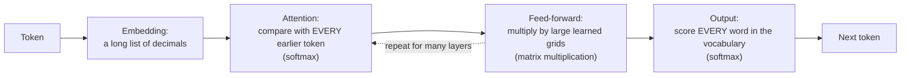

# What UOR-R4 is

**In one paragraph.** UOR-R4 is an attempt to build a language model, the kind of program behind chat assistants, that is cheap enough to train and run on an ordinary laptop or inside a web browser. Today's language models are *transformers*. They spend most of their effort multiplying very large grids of decimal numbers. UOR-R4 bets that a different toolkit can do the same job for far less: rotations of a geometric object, exact whole-number addresses built from primes, small lookup tables, and an exact memory. This page explains that bet in about five minutes. It is a research project and it is **pre-alpha**. **M1 is complete: 1 of 8 milestones**, but no model built under its rules holds a useful conversation yet ([PLAN](../../PLAN.md), [STATE](../../STATE.md)).

![Four panels read left to right. Panel 1: the words "the cat sat on the" split into numbered pieces. Panel 2: each piece becomes an address, drawn as a point on a ring of evenly spaced points (a stand-in for the geometric object), labelled "4 blocks of 8 whole numbers". Panel 3: the newest piece looks at only a few nearby earlier points, which are highlighted, while the rest of the history stays grey. Panel 4: a few labelled drawers open near what was read, and the nearest word inside them, "mat", is picked. A band under all four panels reads "whole numbers: adds, compares and table look-ups, with integer multiply and divide allowed".](../figures/start/hero-how-it-thinks.svg)

*How UOR-R4 predicts the next word. Each step uses only whole numbers. The picture shows the design; it does not show a model that already works well.*

Words in **bold** are defined in the [glossary](./glossary.md). Claims are labelled **proof** (follows from definitions or code), **measurement** (from a recorded run) or **hypothesis** (an untested idea), as in [`docs/formal_vocabulary.md`](../formal_vocabulary.md).

## What a language model does

A language model reads text and guesses what comes next. First a **tokenizer** cuts the text into numbered pieces called **tokens**. A token is a word or part of a word. UOR-R4's tokenizer has 4,096 pieces ([tokenizer](../mechanisms/tokenizer.md)). The model then looks at the pieces so far and predicts the next one. Given "the cat sat on the", a good model puts "mat" near the top of its list. It appends its guess and repeats.

Everything a chat assistant does, answering, summarising, writing code, comes from running this one loop many times. So a model is only as good as its next-piece guesses, and only as fast as one turn of the loop.

## What a transformer is, and where its cost goes

A **transformer** is the design behind almost every modern language model (background: Vaswani et al., "Attention Is All You Need", 2017, arXiv:1706.03762). One turn of its loop looks like this:

*One turn of a transformer. The three expensive operations are named in brackets.*

Three operations carry most of the cost:

1. **Matrix multiplication.** Each token is carried as a long list of decimal numbers. Every layer multiplies that list by large learned grids of numbers. Nearly all of the arithmetic is here.
2. **Attention.** To decide what matters, the newest token is compared with every earlier token. The work grows with the length of the text, and the model keeps a stored copy of every earlier position.
3. **Softmax.** Scores are turned into probabilities with exponentials and a sum over everything, once inside attention and once over the whole vocabulary to choose the next word.

The project bans two of the three outright, softmax-like squashing functions and matrix multiplication, anywhere: training, evaluation, tools and serving ([charter](../../CHARTER.md), sections 3.2 and 3.3). All-pairs attention is not banned as an idea; it is replaced by bounded reads of a few nearby tokens. The reason, in the owner's words: "my goal with all of these bans is to ban expensive operations" ([charter](../../CHARTER.md), section 1).

## The bet: geometry and exact memory instead

UOR-R4 replaces each expensive part with something cheaper:

| Transformer part | UOR-R4's replacement |
|---|---|
| A long list of decimals per token | A short **address**: 4 blocks of 8 whole numbers, each block a fixed point on a geometric object |
| Compare with every earlier token | A **local read** (a "read" is the step that looks back at earlier text): look at a few nearby earlier tokens, found by their addresses |
| Softmax over every word | **Admission**: open a few "drawers" (called cells) of words near what was read, then pick the nearest word inside them |
| Learned grids of decimals | **Rotations** from a fixed, finite set, plus table look-ups |
| A growing store of every past position | **Exact memory**: write a fact once under an exact name, read it back exactly |

The finished model is meant to run with whole numbers only, never decimals: adds, subtractions, comparisons, table look-ups and, since 28 October 2026 (D80 and D81), the chip's whole-number multiply and divide. This rule is called **D11** ([charter](../../CHARTER.md), section 3.6). The lead measure of success is **tokens per second** on ordinary hardware ([charter](../../CHARTER.md), section 1).

Whether these replacements can match a transformer's quality is the open question. It is a **hypothesis**. No measurement so far shows it, and the next page says which parts are built and which are missing: [transformer vs geometry](./transformer-vs-geometry.md).

## What "geometry" means here

"Geometry" in this project means a few concrete objects, each chosen because it can be computed exactly with whole numbers. The [geometry section](../geometry/README.md) has one illustrated chapter for each.

**A token's address is built from fixed points.** Each of the 4,096 tokens owns 4 blocks of 8 whole numbers. Each block is always one of 16 fixed points of a famous eight-dimensional lattice called **E8**. Every such point is a signed rearrangement of (2, 2, 0, 0, 0, 0, 0, 0): two of the eight places hold 2 or −2 and the rest are zero. There are $16^4 = 65{,}536$ possible addresses, more than the 4,096 tokens, so every token can have its own (**proof**, by counting; see [the model page](../model/architecture.md)). The model does not yet use all 240 points of E8 ([E8, H4 and the 600-cell](../geometry/e8-h4-and-the-600-cell.md)).

**Moving means rotating.** Changing a block means swapping one fixed point for another, which is a rotation from a finite set. Nothing is rounded, so a rotation can always be undone exactly ([quaternions and rotation](../geometry/quaternions-and-rotation.md)).

**Names come from primes; starting places from zeta phases.** Each token can be named exactly by a prime number, and that name never collides with another. Separately, angles taken from the zeros of the Riemann zeta function (a fixed, reproducible set of numbers from mathematics) scatter the tokens' starting addresses. One such construction, PrimeZeta, gives all 4,096 tokens distinct starting addresses (**measurement**, [construction record](../../archive/labs/prime-zeta-construction-2026-10-14/README.md)). The distinctness comes from a cell-balancing step, not from the zeta angles. A zero-update comparison found no admission advantage over simple injective controls; a trained effect remains untested ([primes and zeta phases](../geometry/primes-and-zeta.md), [comparison](../labs/r-prime-zeta-vs-nulls/README.md)).

**Near means few steps apart.** Distance between two addresses is the sum of the differences between their numbers, which needs only subtraction and addition. "Nearby earlier tokens" and "the nearest word" both use this distance ([the model page](../model/architecture.md)).

**Learning means trying the legal moves.** The discrete M1 path does not use calculus. To learn, it tries all 16 legal values of one block on the graphics card and keeps a change only if a whole-number score strictly improves. The separate FBS path trains offline with floating point and reports its export gap ([training](../model/training.md), [discrete learning](../mechanisms/discrete-learning.md)).

## The two model paths as of 30 Oct 2026

The saved 19-table `trunk-joint-pointer-v1-d11` model is the discrete path that closed M1. A second,
separate float-trained trunk called FBS carries the complete-reply research; it has not joined the
M1 model ([pipeline map](../model/pipeline-map.md)). On the FBS path:

- The trunk **routes**. A recurrence with a Hamilton gate and a SpiralCore rotation carries position. A Hamming read (XOR and popcount over 64-bit codes) copies words seen earlier.
- Exact memory **stores**. Memory keyed by the user's first 8 tokens names 598.7 and 598.3 of DEV's 1,226 reply openings at two seeds, against 266.3 and 281.0 for an empty-table control (claude-161). It moves only the first word of a reply. After it, replies are still templates.
- The model is **served as integers**. On an M1 laptop a served token runs at 4,217 to 4,504 tok/s under the exact `lut-stack/5` contract (claude-182, claude-186). The served model is inside the export-gap bar on both seeds: net 6 and −8 rows against F_I 24 on DEV (claude-182). The `/7` engine serves the opening and later-reply memory tables on synthetic fixtures; trained-artifact parity and memory-session restore remain open.
- Text in and out (R7) is not built. The artifacts take token ids only.

M1 is complete on the discrete model, not this FBS trunk. [Where we are](./where-we-are.md) has the
full status and its limits.

## Where it stands

| Item | State | Source |
|---|---|---|
| Milestones complete | **1 of 8 (M1)** | [PLAN](../../PLAN.md), rendered [STATE](../../STATE.md) |
| Whole-number serving engine | Built. Native and WebAssembly audits pass; integer multiply and divide are allowed, floats remain banned | [WASM runtime record](../labs/wasm-serving-runtime-2026-10-18/README.md), [serving dossier](../mechanisms/lut-serving.md) |
| A model trained under today's rules in that engine | The saved discrete M1 pair and a separate FBS export exist; neither is useful chat or a released product. New work uses the lab's pre-run review, not a blanket owner hold | [where we are](./where-we-are.md), [charter](../../CHARTER.md) section 5 |
| Saved M1 model | 7,002 and 7,001 correct first guesses out of 14,287 on DEV, above unigram 1,226 and T2 6,300; p-f 7,850 and 7,872 | [M1 close](../labs/m1-close-saved-model/README.md), [bar-f report](../loop/tasks/m1-heldout-phrasing-transfer/claude-211/REPORT.md) |
| Apple M1 decode for the M1 pair | Bar-f remeasurement 10,876 and 10,566 tokens per second, with a 192-token prefill and 64-token decode; older close-grade bar (c) 11,026 and 10,573 | [bar-f report](../loop/tasks/m1-heldout-phrasing-transfer/claude-211/REPORT.md), [close grade](../labs/m1-close-saved-model/README.md) |

M1 reads new prompt phrasings into known reply kinds; 62.5% of p-f's reference replies are verbatim TRAIN replies, so this is not useful conversation. K16's older 65 and 463 are history, not the current best. [Where we are](./where-we-are.md) explains both the result and its limits.

## Go deeper

- [Transformer vs geometry](./transformer-vs-geometry.md): each transformer part beside its replacement, with status.
- [Where we are](./where-we-are.md): what works, what does not, and the measured results.
- [Where we're going](./where-were-going.md): the eight milestones, the shortest path and the products.
- [The model, end to end](../model/architecture.md): one piece of text through the real pipeline.
- [Mechanism board](../mechanisms/README.md): all 28 mechanisms and their status.
- [Charter](../../CHARTER.md): the mission and the rules.
