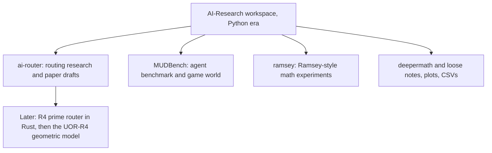

# AI-Research: the original root research workspace

Before there was a Rust language model, there was a Python workspace called AI-Research. It held the first experiments on routing information by geometry instead of by dense attention, a benchmark for AI agents in a game world, and some small mathematics studies. This project is a snapshot of that workspace, kept so the history can be traced. The claims inside it are from the Python era and belong to that workspace; they are not claims about the current model, which is pre-alpha.



*The workspace's four parts. Only the router line leads to the current model.*

## What is in the project

The snapshot has 3,335 files and about 358 MB (`research-archive/2026-10-19/files.sha256` in the store; sizes from the audit inventory `docs/labs/repo-renormalization-2026-10-19/audit/folders.json`). The inventory counts about 10 MB of code across 678 code-like files (669 of them Python), around 207 MB of JSON, CSV, log and NPZ data, about 28 MB of images and about 119 MB of documents (1,037 Markdown files, 123 LaTeX files, 93 PDFs).

| Part | Size | What it is |
|---|---|---|
| `ai-router/` | about 335 MB (router-research about 229 MB, preprints about 101 MB) | Geometry-native routing research: transport laws, wheel-based experiments on prime admissibility, run outputs, a staged "kill list" tracker, and the paper 1 manuscript rebuilds (versions 1 to 4 and a submission bundle) with a `claims_to_evidence_table.md` |
| `MUDBench/` | about 3.7 MB | A benchmark and game-world runtime for evaluating agents: specifications, source in `src/`, tests, scenarios, a scoring spec |
| `ramsey/` | about 2.2 MB | Scripts and result tables for recursive Ramsey-style studies |
| `deepermath/` | about 1.8 MB | Early prime-router scripts and a few papers |
| loose files | the rest | Plots and CSVs from wheel experiments (moduli 210, 2310 and 30030), base-fiber admissibility, and transport-error comparisons across three configurations |

The workspace's own entry points are `README.md`, `PROJECT_MAP.md` and the router's `docs/research/KILL_LIST_TRACKER.md` and `ACTIVE_STATE.md`. Its paths in `PROJECT_MAP.md` point to a different machine and no longer resolve.

## What it claimed

The workspace's `EVIDENCE_SUMMARY.md` lists what it had explored, each with "Observed" and "Unknown" lines. For example, geometric routing produced sparse activation in prototypes, with long-range stability and scaling listed as unknown. In its prime admissibility work, a shared transport law fitted on wheel sizes 2310, 30030 and 510510 is described as generalizing to the unseen size 9699690 with only small degradation, and the note itself says this is evidence for reusable structure and not for exact closure or a "prime oracle".

Treat these as the old workspace's statements. This page reports what the files say, not what was reproduced. Several nested copies of the same material exist inside the snapshot; the labels such as "canonical" apply to the old source repository.

## Where it stands

| Statement | Kind | Evidence |
|---|---|---|
| The snapshot is 3,335 files and about 358 MB | measurement | `files.sha256` (count); sizes from the audit inventory `docs/labs/repo-renormalization-2026-10-19/audit/folders.json` |
| It contains router experiments, an agent benchmark and small math studies | measurement (file listing) | `research/ai-research/README.md` |
| The router results transfer to the Rust model | hypothesis. The model's own tests are the evidence | see [the mechanisms](../../docs/mechanisms/README.md) |
| Any quality claim about language | none. Nothing here trains or scores a language model for conversation | project README |
| Duplicates | 1,799 of its 3,117 distinct file hashes also appear in `prime-analysis`; 10 appear in `research-archives` | `files.sha256` comparison, 19 October 2026 |

## Where the originals are

The full project is preserved in the private Hugging Face dataset `caseyallard/uor-r4-store` under `research-archive/2026-10-19/tars/ai-research.tar` (377,595,904 bytes, 3,335 files, SHA-256 `dbdb1fa6f09712b9faba207a0188d23d0a591c9773cdcbb7ec6aeb21b8ddf1ce`). Every file inside is listed in `files.sha256`, and the tar is listed in `tars.sha256`.

## Source files

The owner decided on 20 October 2026 that this project's code stays in the store, because it is too large to commit: about 10 MB of source in 809 files. This folder holds two things instead:
- [`INDEX.tsv`](INDEX.tsv), which lists every file with its size and SHA-256 (3,335 rows);
- the restore commands in **Restore** below.

The data (CSV, NPZ, images and PDFs) also stays in the store.

## Restore

The code is not committed here. [`INDEX.tsv`](INDEX.tsv) lists all 3335 files of the project, one row each: `path<TAB>size<TAB>sha256`, with the path relative to the project folder, the size in bytes from the owner's local copy (20 October 2026) and the hash from `files.sha256`. To restore the files (the tar sits under `tars/` in the dataset; the two checksum files sit one level above it):

```sh
hf download caseyallard/uor-r4-store research-archive/2026-10-19/tars/ai-research.tar research-archive/2026-10-19/tars.sha256 research-archive/2026-10-19/files.sha256 --repo-type dataset --local-dir .
cd research-archive/2026-10-19/tars
grep ' ai-research.tar$' ../tars.sha256 | shasum -a 256 -c -
tar xf ai-research.tar
grep '  ./ai-research/' ../files.sha256 | shasum -a 256 -c --quiet -
```


## Go deeper

- [Prime Analysis](../prime-analysis/README.md), which overlaps heavily with this snapshot.
- [Research archives](../research-archives/README.md), the Gemini-era sandbox.
- [Primes and zeta](../../docs/geometry/primes-and-zeta.md) and the [mechanism index](../../docs/mechanisms/README.md) for what carried into the current model.
