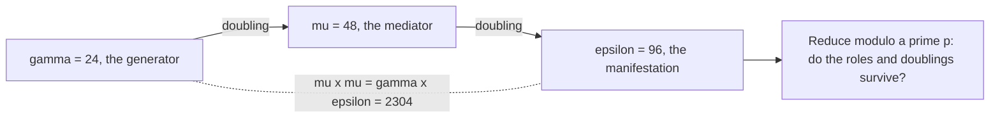

# MSA: Modular Structural Arithmetic

Modular Structural Arithmetic (MSA) is a small formal system for arithmetic with a few special numbers in it. It was written by Alex, a collaborator, and given to this project with his consent as source reading. The folder holds two short papers and nothing else: no code, no data, no experiments. It is a third-party idea that earlier route-attention and selector work in this repository pointed to. It is not part of the language model, and no result here measures anything about the model.

*The three constants of Structural Arithmetic and the question Modular Structural Arithmetic asks about them.*

## What the papers contain

**Structural Arithmetic (SA), 10 pages.** SA starts from ordinary arithmetic (Peano-style axioms for successor, addition and multiplication) and adds three named constants: $\gamma=24$ (the generator), $\mu=48$ (the mediator) and $\varepsilon=96$ (the manifestation). Each doubles into the next, $\delta(\gamma)=\mu$ and $\delta(\mu)=\varepsilon$, which the paper calls the doubling cascade. It also states the "fundamental equation" $\mu\times\mu=\gamma\times\varepsilon$. Numbers are classed by role as generators, mediators or manifestations, with axioms about how the roles are closed under operations such as greatest common divisor and least common multiple, and an induction schema over the structures built this way.

**Modular Structural Arithmetic (MSA), 6 pages.** MSA is described as a conservative extension of SA: it adds reduction modulo a number $p$ and asks which moduli keep the structure intact. Three predicates carry the idea:

- $\mathrm{DP}(p)$, doubling-preserving: the reduced doubled constant equals the doubled residue, with no second reduction (for example mod 7 it fails: $2\times6=12$ is not 5).
- $\mathrm{RP}(p)$, role-preserving: the three constants stay distinct mod $p$.
- $\mathrm{SP}(p)$, structural-preserving: both of the above.

The paper then states special cases as axioms. For example, mod 11 the constants become 2, 4 and 8 (the "11-theorem"), and mod 7 they become 3, 6 and 5, which sum to a multiple of 7 (the "7-vanishing"). It also axiomatizes a "modular resonance" and a resonance period.

**Checks anyone can do by hand (proof, by arithmetic).** $48^2=2304=24\times96$; $24,48,96 \bmod 11 = 2,4,8$; $24,48,96 \bmod 7 = 3,6,5$ and $24+48+96=168=7\times24$. These confirm the numerical facts the axioms state. They do not show that the axiom system is consistent or that its larger claims, such as the characterization of doubling-preserving primes (axiom MSA9), hold; the papers present these as axioms, and this page has not checked that they follow from the others.

## Why it is here

The repository's earlier route-attention and selector work referenced MSA as part of a modular-structure research direction (`research/msa/README.md`). This page claims no tie to the model's geometry, and none has been tested. Any such link would be a hypothesis needing its own experiment.

## Where it stands

| Statement | Kind | Evidence |
|---|---|---|
| The folder contains two PDFs (6 and 10 pages) and a README, 3 files in all | measurement | `files.sha256` |
| The constants and special-modulus facts above are true arithmetic | proof (direct calculation) | shown above |
| MSA is a conservative extension of SA, and the rest of its axiom claims | not checked here; the README asserts the extension property | `research/msa/README.md` |
| MSA helps the model | hypothesis, untested | none |

## Permission and attribution

Both papers are by Alex. The README states they are included "with the author's consent" and were contributed to the research archive by Casey Allard. The folder inventory flags that redistribution permission should be confirmed before the PDFs are committed to a public repository. Until the owner confirms it, the PDFs remain in the store and the folder holds the README and a hash-and-pointer file; once confirmed they can be committed with attribution (they total about 0.3 MB).

## Where the originals are

The full project is preserved in the private Hugging Face dataset `caseyallard/uor-r4-store` under `research-archive/2026-10-19/tars/msa.tar` (338,432 bytes, 3 files, SHA-256 `73be0abc4ff823d00b35bab447e4f1928b45a478f9479dec84efa9504f1dd0b0`). Every file inside is listed in `files.sha256`, and the tar is listed in `tars.sha256`.

## Code

`code/` holds 1 file (777 bytes) copied byte for byte on 20 October 2026 from `research/msa` (backed up as `msa.tar`): the original `README.md`. The folder has no code; the two papers are PDFs and stay in the store pending the permission check above. No absolute paths, no licence file.

## Go deeper

- [Project index](../README.md) for the other side projects.
- [Glossary](../../docs/start/glossary.md) for terms used on this page.
- Earlier route-attention records that cite MSA are in `archive/` (see the mechanism pages under `docs/mechanisms/` for the current status of routing mechanisms).
