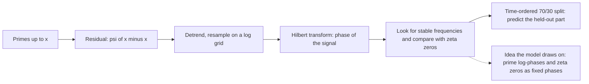

# Prime Analysis: the Prime Phase and Chebyshev psi spectral program

Prime numbers look random, but their running count wobbles around a smooth curve in a way that has long been tied to the zeros of the Riemann zeta function. This project asked whether that wobble (the Chebyshev residual $\psi(x)-x$) carries a structure that can be recovered and used to predict where primes fall. It is a pile of research notes, slide decks, simulations and scripts. Its own README calls it a late, concluding collection of the prime-router studies; the ancestry runs from the AI-Research workspace to a Python prime router, to this program, to the Rust model. The model's ideas about prime addresses and zeta phases draw on it. It is **not a proof of the Riemann hypothesis, and not evidence that the language model works.**



*The program's pipeline as its own notes describe it. The dashed arrow is a transfer of an idea, not a transfer of a result.*

## The question and the method

Let $\psi(x)=\sum_{n\le x}\Lambda(n)$ be the Chebyshev function, where $\Lambda$ is the von Mangoldt function. The explicit formula writes the residual as a sum over the non-trivial zeros $\rho=\tfrac12+i\gamma$ of the zeta function:

$$\psi(x)-x \;=\; -\sum_{\rho}\frac{x^{\rho}}{\rho}\;+\;\text{small terms}.$$

Each zero contributes an oscillation whose frequency is set by $\gamma$. The program treats the residual as a signal and asks whether those oscillations can be seen and extrapolated. The notes describe a fixed ("fingerprint-locked") pipeline: causal detrending (no use of future data), resampling on a uniform log grid, analytic phase through a Hilbert transform, and time-ordered 70% train / 30% test splits so that prediction is judged out of sample.

The program also developed a geometric side: the R4 Prime Router, Hopf-base sector discretization, and an H4 x H4 coupled field. Those briefings are one source of the model's prime-routing language.

## What is in the project

| Folder | Size | What it holds |
|---|---|---|
| `research/` | about 201 MB | About 30 briefings and study guides in Markdown, two CSV tables, manuscripts, and `theoretical-mathematics/` with six sub-collections (ramsey-divisor-study, prime-number-theory, formal-math-lean, golden-harmonics, geometric-routing-hopf, theoretical-physics-uor) |
| `images/` | about 229 MB | Slide exports, mind maps and diagrams (JPG and PNG) |
| `photos/` | about 104 MB | Mostly the same images again under the same names |
| `simulations/` | small | Six interactive HTML pages (router visualizer, 3D zeta explorer, dissertation simulator and others) |

In total: 7,708 files, of which 2,644 are Python (about 1,390 are the program's own; 1,257 are vendored third-party packages such as numpy and numba under `formal-math-lean/.vendor`), 363 are LaTeX, and 3,167 are Markdown (`research-archive/2026-10-19/files.sha256` in the store; counts from the folder inventory). Despite the name, `simulations/` holds only the six HTML pages. Almost all of the Python is under `research/theoretical-mathematics/`.

**Caution on provenance.** Many of the Markdown briefings appear to be AI-generated study guides built from the owner's papers and slides. The collection also contains third-party papers, personal documents and a provisional patent filing. Those need a licensing and privacy review before any of them is committed; until then they stay in the store.

## Duplicates to remove at import

- The 185 Python files in `formal-math-lean/` are byte-identical to the 185 in [`riemann-lean/`](../riemann-lean/README.md) (measurement: byte comparison of the local copies, 19 October 2026). That folder holds no Lean files. Keep one copy, in `riemann-lean`.
- `photos/` repeats `images/` by name for at least some files (for example one 4.9 MB dashboard image appears in both).
- 1,799 of the 3,117 distinct file hashes in [`ai-research/`](../ai-research/README.md) also appear here (measurement from `files.sha256`). The overlap includes folders with the same names (for example Ramsey and MUDBench material). Import by hash, not by path.

## Where it stands

| Statement | Kind | Evidence |
|---|---|---|
| Peaks extracted from the residual beat phase-randomized surrogate signals ($p\approx0.039$) | reported claim, unverified: the cited note is a prose synthesis, not a run output, and the underlying run outputs were not inspected for this page | `research/Spectral-Phase Dynamics in Prime Density Modeling_ A Synthesis of Research Outcomes and Validation Rigor.md` |
| The peaks align with zeta zeros no better than with random frequencies of the same density ($p\approx0.62$) | reported claim, unverified (same note) | same |
| A truncation to about 300 zeros restores the phase geometry of the signal | same | same |
| The residual's structure can predict primes out of sample | hypothesis. This page cites no final held-out prediction result | same |
| The Riemann hypothesis follows | not claimed. The project's own README says it is scoped research | `research/prime-analysis/README.md` |
| Relevance to the model | The zeta-phase and prime-address ideas fed [the prime/zeta codebook](../../docs/mechanisms/prime-zeta-codebook.md); the model's results are separate | mechanism page |

The second row matters for the model: the program's own controls found no special link between its spectral peaks and the zeta zeros beyond their density. The model uses zeta zeros as fixed phases, which does not depend on that link, but it should not be sold as one.

## Where the originals are

The full project is preserved in the private Hugging Face dataset `caseyallard/uor-r4-store` under `research-archive/2026-10-19/tars/prime-analysis.tar` (566,219,264 bytes, 7,708 files, SHA-256 `25747ed4345b510f85187d119db17cc5b2ee01f2f8f791f8a952d9a44970f36e`). Every file inside is listed in `files.sha256`, and the tar is listed in `tars.sha256`. The project's own README names GitHub repositories and hosted pages under `Casey-allard`; no separate remote is recorded in the folder itself.

## Source files

The owner decided on 20 October 2026 that this project's code stays in the store, because it is too large to commit: about 46 MB of Python and TeX in 3,034 files. This folder holds two things instead:
- [`INDEX.tsv`](INDEX.tsv), which lists every file with its size and SHA-256 (7,708 rows);
- the restore commands in **Restore** below.

The images, photos, PDFs, DOCX files and manuscripts also stay in the store.

## Restore

The code is not committed here. [`INDEX.tsv`](INDEX.tsv) lists all 7708 files of the project, one row each: `path<TAB>size<TAB>sha256`, with the path relative to the project folder, the size in bytes from the owner's local copy (20 October 2026) and the hash from `files.sha256`. To restore the files (the tar sits under `tars/` in the dataset; the two checksum files sit one level above it):

```sh
hf download caseyallard/uor-r4-store research-archive/2026-10-19/tars/prime-analysis.tar research-archive/2026-10-19/tars.sha256 research-archive/2026-10-19/files.sha256 --repo-type dataset --local-dir .
cd research-archive/2026-10-19/tars
grep ' prime-analysis.tar$' ../tars.sha256 | shasum -a 256 -c -
tar xf prime-analysis.tar
grep '  ./prime-analysis/' ../files.sha256 | shasum -a 256 -c --quiet -
```


## Go deeper

- [Primes and zeta](../../docs/geometry/primes-and-zeta.md) and the [prime/zeta codebook mechanism](../../docs/mechanisms/prime-zeta-codebook.md).
- [Riemann-Lean](../riemann-lean/README.md) for the Lean scaffold built from this program's probes.
- [Glossary](../../docs/start/glossary.md).
