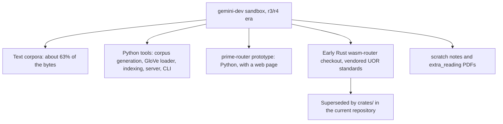

# Research archives: the Gemini-era sandbox

This folder is a time capsule. In an early stage of the project (the "r3/r4 era"), the owner built a development sandbox with an AI assistant: text corpora, small Python tools that generate and index them, a first "prime router" prototype, and an early Rust checkout of a WebAssembly router. It is kept because it shows how the ideas started. It is not a live project, it does not run the current model, and it contains no result that the current model relies on.

*What the sandbox contains. The Rust part has been replaced by the current workspace.*

## What is in the project

All of it sits under `gemini-dev/`. The folder is 99 MB in 128 files (`research-archive/2026-10-19/files.sha256` in the store; sizes from the audit inventory `docs/labs/repo-renormalization-2026-10-19/audit/folders.json`). About 65 MB of that is data (JSON, NPZ, token files and text corpora) and about 37 MB is documents.

| Part | Size | Notes |
|---|---|---|
| `wikitext2_proxy/` | about 62 MB | A stand-in for the WikiText-2 language-modelling corpus |
| Corpora (`complex_corpus.txt`, `universal_corpus.txt`, `wiki_corpus.txt`, world-model corpora) | about 12 MB, 11 MB, 3 MB and smaller | Text used by the prototype tools |
| `prime-router/` | about 3.4 MB | A Python prototype: "Evolving Hypersphere Brain World Model" with a web page and a CLI |
| `extra_reading/` | about 2.9 MB | Research PDFs with text extracts |
| `rust/` | about 0.6 MB | An early `uor-r4-wasm-router` checkout with vendored UOR standards; its engine file is `uor_r4_router_engine.rs` |
| Python tools | 55 `.py` files overall | Corpus generation, a GloVe loader, large-corpus indexing, a server and a CLI |
| `scratch/`, `zeta_data/` | small | Working notes and zeta-zero data |

The original README says the GloVe and manifold caches (about 490 MB) and a nested copy of the AI-Research workspace were left out of this snapshot.

**One thing to know before reading the code.** The prototype describes a "zero-weight" geometric text generator, and it also offers a mode that connects to a locally running transformer through Ollama for comparison. The current charter forbids neural comparators and controls, so nothing in this folder is run or revived; it is preserved as history only.

## Where it stands

| Statement | Kind | Evidence |
|---|---|---|
| The sandbox is 128 files, about 99 MB | measurement | `files.sha256` (count); sizes from the audit inventory `docs/labs/repo-renormalization-2026-10-19/audit/folders.json` |
| The prototype's "zero-weight" generation worked as described | hypothesis, not tested for this page | `gemini-dev/prime-router/README.md` is the only source |
| Any part of it is on the current model path | no | The Rust checkout is superseded by the current crates; the folder is marked archive |
| Overlap with other projects | 10 file hashes are shared with `ai-research` and 10 with `prime-analysis` | `files.sha256` comparison, 19 October 2026 |

## Where the originals are

The full project is preserved in the private Hugging Face dataset `caseyallard/uor-r4-store` under `research-archive/2026-10-19/tars/archives.tar` (103,435,776 bytes, 128 files, SHA-256 `2553007578044fa4f5f7000714a633b0693d7714f80cb999e0671e7ee71e78b2`). Every file inside is listed in `files.sha256`, and the tar is listed in `tars.sha256`. The tar is named `archives`; the folder here is called `research-archives`.

## Source files brought into this folder

Only scripts and notes come in, as an index of what existed:

- `README.md`
- `gemini-dev/*.py`
- `gemini-dev/prime-router/**`
- `gemini-dev/scratch/**/*.md`
- an index (a listing, not the files) of `gemini-dev/rust/**/*.rs`, since the current crates replace it

Stay in the store: `wikitext2_proxy/`, the corpora, all NPZ and token files, the `extra_reading` PDFs and `zeta_data/`.

## Go deeper

- [AI-Research](../ai-research/README.md), the workspace that grew alongside this sandbox.
- [Prime Analysis](../prime-analysis/README.md), the research collection that took these ideas further.
- [Mechanism index](../../docs/mechanisms/README.md) for what the current model actually uses.
- [Glossary](../../docs/start/glossary.md).
