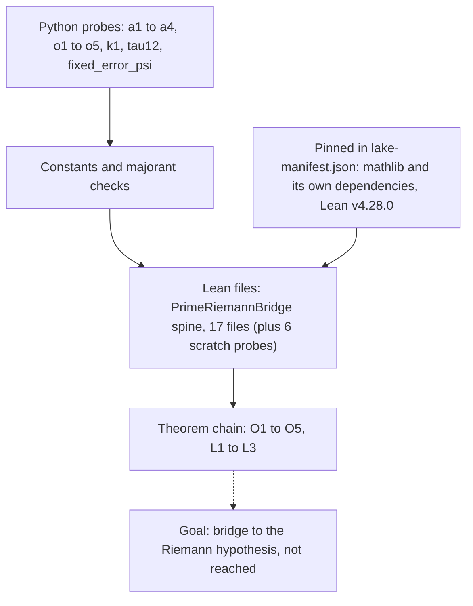

# Riemann-Lean: a Lean 4 scaffold for a prime-number proof chain

This project is an attempt to write a proof about prime numbers in a proof assistant called Lean 4, where a computer checks every step. The goal was to connect how primes are spread out to the Riemann hypothesis, a famous open problem about the zeros of the zeta function. The result is a scaffold: a chain of statements with the pieces needed to prove them, plus 185 Python scripts that probe whether the needed inequalities hold. **The Riemann hypothesis is not proved here, and nothing in this folder is evidence about the language model.**

*Probes feed constants into the Lean spine. Mathlib is pinned, not copied; the project README also names Lean-RH, PhysLean, Carleson and PrimeNumberTheoremAnd, which are not pinned and not imported. The last arrow is the goal, not a result.*

## What is in the project

- `formal/lean/`: the `PrimeRiemannBridge` theorem spine. The folder holds 23 `.lean` files: 17 spine files plus 6 small scratch probes (dot-prefixed `.codex_*` files, a few lines each). The project README states no axioms; a search of the 23 files finds no `axiom` declaration (two comment lines only). It comes with `lakefile.toml` (which requires only mathlib), `lake-manifest.json` (mathlib and its transitive packages), a Lean v4.28.0 `lean-toolchain`, and three verification scripts.
- 185 Python scripts at the top level: probes, ledgers, majorant checkers and proof-obligation tooling, grouped by prefix (`a1` to `a4`, `o1` to `o5`, `k1`, `tau12`, `fixed_error_psi`, `spinning_top`, `build_*`).
- `data/`: reference data (19 JSON files: 12 arXiv listings and 7 zeta-zero tables from LMFDB and Odlyzko; sizes not re-checked here).

A "majorant" is an upper bound that dominates the quantity being studied; most scripts check numerically that such a bound holds in a range, or turn a bound into a constant for the Lean files. A numerical check in a range is not a proof for all numbers.

Casey Allard started this as a standalone local project. It was never part of the AI-Research or Prime-Analysis repositories (`research/riemann-lean/README.md`). The external Lean dependencies are fetched with `lake exe cache get` or `lake update`; their sources are not stored here because they are third-party, large and regenerable.

## Relationship to Prime Analysis

The [`prime-analysis/`](../prime-analysis/README.md) project holds a folder named `formal-math-lean`, which contains 185 Python files. Comparing the two trees byte by byte shows all 185 are identical to the ones here (measurement, checked on the local copies on 19 October 2026). The folder in Prime Analysis contains no `.lean` files. So **this project is the canonical home of the Lean spine and of the probe scripts**, and the Prime Analysis copy is a duplicate to be recorded, not imported twice. Which of the two the owner wants as canonical is an open decision; the inventory favours this one because it is small and holds the Lean source.

## Where it stands

| Statement | Kind | Evidence |
|---|---|---|
| The folder holds 23 `.lean` files (17 spine plus 6 scratch probes) | measurement (file count) | hash listing in `files.sha256` |
| No `axiom` declaration in those files; the chain is conditional on imported-result hypotheses | measurement (text search, scope: the 23 files) plus the project's own statement | `formal/lean/README.md`, which says transfer assumptions are still to be replaced |
| The spine builds against the pinned libraries | not established by this page | Verification scripts exist (`verify_formal_proof*.sh`); no build log was inspected for this page |
| The Riemann hypothesis follows from this chain | hypothesis, unproved | The goal of the scaffold; the project itself does not claim it |
| Probe scripts show the inequalities hold on the ranges tested | measurement for the ranges tested only, if the scripts are run | The scripts are in the project; their outputs were not inspected for this page |
| Relevance to the model | none on the model path | Charter: side project |

The words "formalization scaffold" in the README are the correct reading. Treat any numerical agreement as exploration.

## Where the originals are

The full project is preserved in the private Hugging Face dataset `caseyallard/uor-r4-store` under `research-archive/2026-10-19/tars/riemann-lean.tar` (7,279,616 bytes, 248 files, SHA-256 `45b4a16ed2fbca6d99595299b697e09569747d468de39bb94a33ee3307cd455d`). Every file inside is listed in `files.sha256`, and the tar is listed in `tars.sha256`.

## Code

`code/` holds 234 files (2,102,410 bytes) copied byte for byte on 20 October 2026 from `research/riemann-lean` (backed up as `riemann-lean.tar`): the Lean sources under `formal/lean/` with `lakefile.toml`, `lake-manifest.json` and `lean-toolchain`, the top-level Python probes and shell scripts, the Markdown notes, and the five `data/*.json` files the probes read (all under 64 KB). Excluded: 14 data JSON files (11 that no code reads, one between 64 KB and 512 KB, and two zeta-zero tables over 512 KB), and every file under `.lake/`. No licence file or vendored third-party source was found. One file contains 2 absolute `/Users/` paths, left unchanged. The code is preserved research and is not run by this repository.

## Go deeper

- [Prime Analysis](../prime-analysis/README.md) for the manuscripts and the theory notes behind this scaffold.
- [Primes and zeta](../../docs/geometry/primes-and-zeta.md) for how the model uses zeta zeros (a fixed list of phases), which is a different use from proving a statement about all of them.
- [Glossary](../../docs/start/glossary.md).
