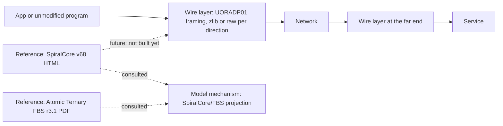

# SpiralCore: networking protocols and compression

SpiralCore is a set of geometry ideas (by Matthew) that the language model borrows: a fixed graph of rotations in eight dimensions, with exact bookkeeping of the path taken between two points. This project poses a different question about the same family of ideas: could they help move and shrink data across a network? That question is posed here, not yet tested: the code that exists uses plain zlib framing with no SpiralCore routing. The folder also keeps two SpiralCore references. It is a side project. It is not wired into the model's training or serving, and nothing here is evidence that the model works.

*Left: the wire transport that exists today. Right: the two preserved references, which were consulted but are not the build source of the model's mechanism (that follows a v63 reference and a hosted v69 file). The dashed line from the reference to the wire layer is a plan, not code.*

## What is in the project

The project has two parts that arrived at different times.

**1. The wire transport exploration (code).** One framing for compressed traffic, exposed four ways: a pair of proxies (a plain app talks to a local edge, the edge talks compressed to a gateway, the gateway talks to the service), a socket library the app links directly, a process interposer that makes unmodified programs use the wire (on macOS through `DYLD_INSERT_LIBRARIES`, on Linux through `LD_PRELOAD`), and opt-in multiplexing of several streams over one connection (UORADM01). The framing starts with a UORADP01 handshake, then length-prefixed frames with a raw-flag bit, so each direction can send zlib-compressed or raw data. There are 36 tool files (16 Python, 17 shell, 3 C) and a Rust crate, `wire-rs`, that is not part of the model's Cargo workspace.

This work lives at [`wire/`](wire/) (82 files). It was copied from a separate review repository at commit `032d903`, which keeps the full history.

**2. The owner-supplied references (documents).** Two sources the owner brought in on 13 September 2026, preserved byte for byte:

| Source | What it is | SHA-256 |
|---|---|---|
| `Spiralcore_Dodecahedron_IP_Schema_v68.html` (about 1 MB) | An executable reference: prompt-trace handler, address functions, E8 addressing and operator routing, a Bell-tone codec, breadth-first search, orbit tracing and a Kuramoto phase solver | `2a45c2e5f46c8c36bf7801da1d1e12ee9e2ed8b3da488ff54c20a6ac6c2ceab0` |
| `atomic-ternary-fbs-reference-r3.1.pdf` (about 3 MB) | "Atomic Ternary FBS Formal Consolidated Reference", revision 3.1 | `917cb942811971d63cbe499f3a1641d3360c4dde7ebdc6b87e298c3cf1bbd747` |

Also kept: `provenance.json` (original paths, byte counts and hashes) and a plain-text extract of the mathematics. The scripts in the HTML file were not executed during import, and its embedded fixture claims were not re-run (`research/spiralcore-v68/README.md`).

## How the pieces fit

The HTML reference defines a fixed graph of rotations over the 16 roots of one E8 anchor orbit, and a search that returns an ordered history between two roots. The model's SpiralCore/FBS mechanism follows a related convention (the v63 reference, implemented in `crates/uor-r4-core/src/spiralcore_operator.rs`, and a hosted v69 file reviewed on 9 October), not this v68 file. The idea is the same family: an output block picks one stored atom and moves it along a short path of signed coordinate swaps (see [the mechanism page](../../docs/mechanisms/spiralcore-fbs.md) and the [geometry explainer](../../docs/geometry/spiralcore.md)). The wire transport does not use any of this yet. Its framing is plain length-prefixed zlib, chosen for interoperability.

## Code

The wire transport code lives in [`wire/`](wire/). It is standalone and is not a member of the repository workspace.

A separate warm-cache networking exploration (DeepSeek, #2808) lives in [`warm-cache/`](warm-cache/README.md); it does not share code with `wire/` and is not a workspace member either.

## Where it stands

| Claim | Kind | Evidence |
|---|---|---|
| The wire framing, socket layer, interposer and mux interoperate: 18 of 18 legs of the interop matrix pass | measurement (loopback, one machine; a manual host regression, not CI; needs a built `objpeer`, and the Linux interposer leg needs an mvm microVM) | `wire/README.md`, `tools/wire_interop_matrix.sh`; lab record `docs/labs/wire-matrix-repro-2026-10-18/README.md` |
| 1 KiB round trip: wire 41.8 microseconds against plain TCP 55.1 microseconds | measurement (loopback, host-load sensitive) | `wire/README.md` |
| Rust peer, 1.25 MiB compressed: 2.10 / 2.86 / 3.30 ms (min / mean / max); plain TCP 1.52 / 1.92 / 2.16 ms | measurement (loopback) | same |
| Compression backend `zlib-rs` matches `miniz_oxide` on ratio (0.24489 against 0.24480 on a realistic corpus) | measurement | same |
| The framing adds no encryption or authentication | proof (by inspection of the design: none is specified) | same; use TLS, WireGuard or SSH outside it |
| SpiralCore routing helps compression or transport | hypothesis | the README says "no SpiralCore/FBS routing integration" |
| The references improve the language model | hypothesis | the import record (`research/spiralcore-v68/README.md`) calls them consulted references, not model components |

Limits stated by the project itself: loopback numbers depend on machine load; the interposer is macOS and Linux only, numeric IPv4 only, with blocking connect; the residual cost measured is compression CPU, not framing copies or threads.

## Where the originals are

The two references were part of the owner's untracked `research/` folder. The full original tree is preserved in the private Hugging Face dataset `caseyallard/uor-r4-store` under `research-archive/2026-10-19/tars/spiralcore-v68.tar` (3,796,480 bytes, 5 files, SHA-256 `dfcb839d896d47d5eda0afe646da72331a03b080acfa55607bf331e9f8091a05`). Every file inside is listed in `files.sha256` in the parent folder, and the tar is listed in `tars.sha256` there. Copies of the originals also remain in the owner's Downloads folder.

## Source files brought into this folder

- From the former `spiralcore-base/wire`, now [`wire/`](wire/): all 82 files (tools, `crates/wire-rs`, `docs`, bounded `evidence`), unchanged.
- From `research/spiralcore-v68`: `README.md`, `provenance.json`, the mathematics extract, the v68 HTML (placed under `reference/`) and the FBS PDF (about 3 MB; stays in the store if the size policy says so, with its hash recorded here).

## Code

`v68/` holds 1 file (8,080 bytes) copied byte for byte on 20 October 2026 from `research/spiralcore-v68` (backed up as `spiralcore-v68.tar`): its `README.md`. That folder has no code. The HTML reference (about 1 MB) and the FBS PDF are over the 512 KB limit or not source, the mathematics extract is plain text, and `provenance.json` is not read by any code, so all four stay in the store and are checked by `files.sha256`. No absolute paths, no licence file.

## Go deeper

- Records: `docs/labs/spiralcore-wire-side-2026-10-18/README.md`, `docs/labs/wire-counter-aggregation-2026-10-18/README.md`, `docs/labs/wire-matrix-repro-2026-10-18/README.md`, `docs/labs/uorobj01-conformance-2026-10-18/README.md`.
- The older projection records for the model's own use of SpiralCore are in `archive/labs/` (see the [mechanism page](../../docs/mechanisms/spiralcore-fbs.md) for links).
- Related project: [`wasm-gemm-gnaf/`](../wasm-gemm-gnaf/README.md) is another independent side project; it does not use SpiralCore.
