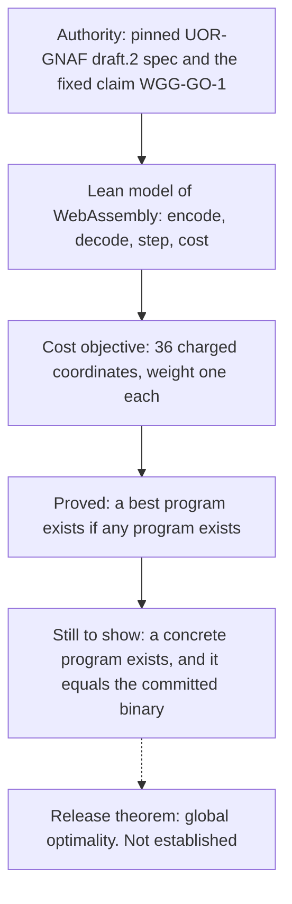

# WASM-GEMM-GNAF: a Lean proof project about a matrix-multiply kernel

This project tries to prove, with a proof assistant called Lean 4, that one specific small program is the best possible program of its kind. The program is a matrix-multiplication kernel (GEMM) written for WebAssembly, the portable code format that runs in browsers. "Best possible" has a precise meaning set by the project: lowest score on a fixed cost formula, among every program that does the same job. The proof is **not finished**. The project's own result today is the honest answer "incomplete". It is a side project: it does not train, serve or test the language model, and the model's own rules forbid dense matrix multiplication, so this work is unrelated to how the model computes. It is outside every model build and every loaded path; whether the model ratchet's scan scope covers this folder was not checked for this page.

*The proof structure. Solid boxes are done; the last arrow is the goal, which has not been reached.*

## What the project is

It is a Lean 4 library of 141 files (about 3.4 MB) with a normative specification (`SPEC.md`), an obligation ledger (`CERTIFICATION.md`), a claim registry (`model/claims.json`), pinned copies of its authority documents under `authority/`, fixtures, tooling and its own licences (Apache-2.0 or MIT, at your option). It currently lives at `proofs/wasm-gemm-gnaf` and moves to this folder.

"GNAF" is the name of the authority document the project follows, UOR-GNAF version 1 draft 2, whose text is pinned by a SHA-256 hash. The requested claim, `GlobalOptimal`, ranges over all finite byte sequences that decode and validate as a WebAssembly module under the chosen profile. It does not range over a hand-picked family of kernels.

## How it works

The project defines a cost vector with 36 charged coordinates and a canonical score, the weight-one sum of those coordinates. It models the binary format and the step relation of a subset of WebAssembly, and shows that its cost instrumentation does not change what a program computes. One key fact: each coordinate is at most the score, so every set of programs below a given score is finite. That lets a minimum exist.

With that, the project proves that **if** some valid program exists, a lowest-scoring one exists and satisfies the optimality statement. What is left is not a bound but an exhibition: build one concrete program with proofs that it qualifies, then show the committed binary is the program the minimum selects.

## Where it stands

All rows come from the project's own README and conformance table (`proofs/wasm-gemm-gnaf/README.md`, `CONFORMANCE.md`, `CERTIFICATION.md`). They are not re-run for this page.

| Statement | Kind | Evidence |
|---|---|---|
| The library has 97 Lean modules, 55,504 lines and 3,146 proved theorems | measurement (generated inventory, Lean 4.30.0) | `CONFORMANCE.md`, first line |
| The proved results contain no `sorry`; their axioms are the three Lean core axioms | measurement (stated by the project, not re-checked here) | `README.md` |
| A lowest-scoring valid program exists, given that at least one exists (`exists_globalOptimal_of_nonempty`) | proof (kernel-checked in Lean, per the README) | `README.md`, table of proved declarations |
| Cost instrumentation is transparent: instrumented and plain runs agree (`costed_run_iff_plain_run`) | proof (same) | same |
| Global optimality of the committed binary | **not established** | `README.md` Status block; terminal answer `WorkloadIncomplete` in `CERTIFICATION.md` |
| Open obligations: a concrete nonempty witness (GO-006), identifying the committed bytes with the minimizer (GO-007), full WebAssembly 3.0 semantics beyond the modelled `i32` subset (WS-001), covering all four arithmetic modes (BI-002) | open | `README.md` |
| The WebAssembly core 3.0 specification is vendored | no | pinned by commit, marked not vendored |
| "Optimal" means faster on a real machine | no. It means lowest on the abstract cost formula, and says nothing about latency on any engine | `README.md`, scope section |
| The gate `just vv` fails at step 9 | by design. A green gate in this state would mean the gate had been weakened | `README.md` |

The README forbids editing its status paragraph while the proof is open, and the project rule is: if you cannot prove it, omit it. No unproved statement is stubbed or assumed.

## How it connects to this repository

The root repository's `xtask` tool has `gnaf-*` subcommands (`xtask/src/gnaf_*.rs`, six files on main) that read this tree, and about 26 documents mention it. Those files move together with the project. The repository's manually dispatched workflow `formal_verification.yml` (not scheduled) runs the Kani model checker over a different crate, `uor-r4-proof-model`, not this Lean tree, and no CI step builds the Lean project (folder audit, `docs/labs/repo-renormalization-2026-10-19/audit/folders.json`). Do not read a green CI run as a check on these proofs.

## Where the originals are

This project is already tracked in git, so it has no Hugging Face tar. It is not part of the 19 October backup of the untracked `research/` folder. The source is preserved by `origin/main` itself.

## Source files brought into this folder

All 141 files move with their history by `git mv`, together with the matching `xtask/src/gnaf_*.rs` subcommands and the `xtask` entries that reference the old path. No file is dropped.

## Go deeper

- Inside the project: `SPEC.md` (the contract), `CERTIFICATION.md` (the obligation ledger), `VERIFICATION.md`, `CONFORMANCE.md`.
- [Project index](../README.md) for the other side projects.
- [Charter](../../CHARTER.md) for the model's own rules, which are separate from this project.
- [Glossary](../../docs/start/glossary.md).
